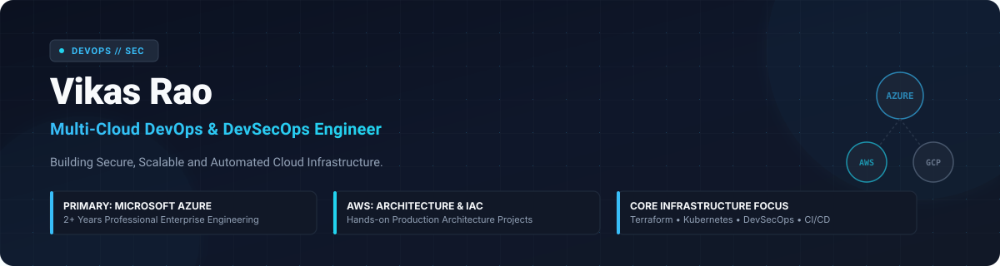
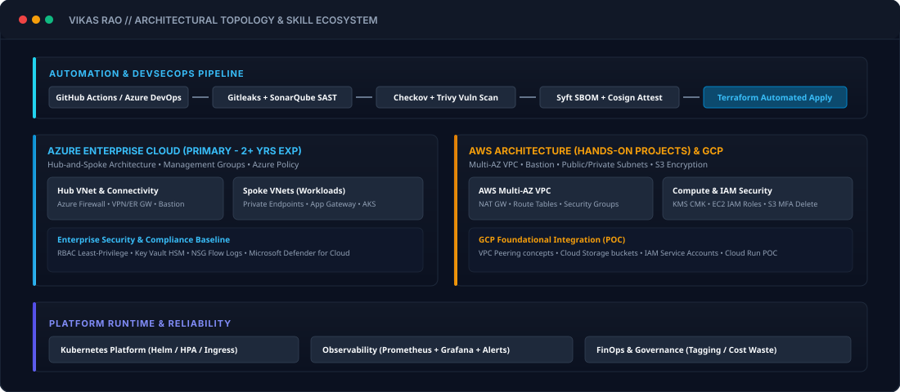

<div align="center">

  

  <br />

  <p align="center">
    <strong>Building Secure, Scalable, and Automated Cloud Infrastructure.</strong>
  </p>

  <p align="center">
    <a href="#-professional-experience"></a>
    <a href="#-flagship-projects"></a>
    <a href="#-poc-laboratory"></a>
    <a href="#-infrastructure-philosophy"></a>
  </p>

</div>

---

## 🧭 Executive Engineering Summary

I am a **Multi-Cloud DevOps and DevSecOps Engineer** with **2+ years of professional engineering experience** specializing in **Microsoft Azure** enterprise cloud infrastructure, automated CI/CD release engineering, and Infrastructure as Code (IaC) with **Terraform**.

My technical foundation centers around zero-trust architectures, shift-left DevSecOps automation, and immutable infrastructure delivery. In addition to my primary professional work across enterprise Azure environments, I actively design and build hands-on infrastructure projects on **AWS** and explore foundational architectural patterns on **Google Cloud Platform (GCP)**.

```
┌────────────────────────────────────────────────────────────────────────────────────────┐
│                                 CORE ENGINEERING STACK                                 │
├──────────────────────┬──────────────────────┬──────────────────┬───────────────────────┤
│ Cloud Platforms      │ IaC & Orchestration  │ CI/CD & Delivery │ Security & Observability│
│ • Azure (Primary)    │ • Terraform (HCL)    │ • GitHub Actions │ • Checkov / Trivy     │
│ • AWS (Hands-on)     │ • Kubernetes / Helm  │ • Azure DevOps   │ • Gitleaks / Syft     │
│ • GCP (Foundational) │ • Docker Compose     │ • ArgoCD (GitOps)│ • Prometheus / Grafana│
└──────────────────────┴──────────────────────┴──────────────────┴───────────────────────┘
```

---

## 💼 Professional & Technical Experience Breakdown

To provide clear technical transparency, my background is partitioned into verified professional enterprise experience and independent hands-on cloud projects:

### 🔷 Primary Professional Experience: Microsoft Azure & DevOps (2+ Years)
* **Cloud Architecture & IaC:** Designed and provisioned scalable Azure resources using modular Terraform (HCL), enforcing remote state locking via Azure Blob Storage with customer-managed access controls.
* **Network & Security Isolation:** Implemented secure Hub-and-Spoke virtual networks, Azure Private Endpoints, Network Security Groups (NSGs), User Defined Routes (UDRs), and Azure Firewall rules.
* **CI/CD Automation:** Engineered robust multi-stage pipelines across Azure DevOps Pipelines and GitHub Actions, incorporating build gates, automated unit tests, and gated deployment approvals.
* **Governance & Compliance:** Applied Azure Policy definitions, Management Group hierarchies, Role-Based Access Control (RBAC) following least-privilege principles, and cost-allocation tagging frameworks.

### 🟧 Hands-on Project Implementation: Amazon Web Services (AWS)
* **VPC Architecture:** Implemented multi-AZ VPC topologies with isolated public, private, and database subnets, NAT Gateways, and secure internet exit filtering.
* **Compute & Storage:** Automated EC2 bastion host access, Auto Scaling Groups with Application Load Balancers, and hardened S3 buckets with KMS customer-managed encryption and bucket policies.
* **IAM Least-Privilege:** Enforced fine-grained IAM roles, boundary policies, and credential-free OIDC federation for GitHub Actions.

### 🟩 Foundational Exposure: Google Cloud Platform (GCP)
* **Foundations & Storage:** Practical exploration of GCP Cloud Storage buckets, service account privilege binding, and foundational VPC network peering patterns.

---

## 🏛️ Architecture & Platform Overview

Below is the high-level architecture diagram representing the technical ecosystem across my projects and automated pipelines:

<div align="center">
  
</div>

---

## 🚀 7 Flagship Production Architectures

Every flagship repository represents a complete, reproducible, and production-structured engineering implementation with automated tests, documentation, and security controls:

| # | Flagship Repository | Primary Tech | Core Focus & Highlights | Status |
| :-: | :--- | :--- | :--- | :-: |
| 01 | [**azure-enterprise-landing-zone**](https://github.com/vikasrao-ops/azure-enterprise-landing-zone) | Terraform, Azure, Policy | Hub-and-Spoke VNet, Private Endpoints, Management Groups, RBAC, Centralized Log Analytics | `Implemented` |
| 02 | [**aws-secure-infrastructure**](https://github.com/vikasrao-ops/aws-secure-infrastructure) | Terraform, AWS, KMS | Multi-AZ VPC, Private Subnets, Bastion Host, S3 Hardening, Least-Privilege IAM Roles | `Implemented` |
| 03 | [**devsecops-platform**](https://github.com/vikasrao-ops/devsecops-platform) | Actions, Trivy, Checkov | Shift-Left Security Pipeline: Gitleaks, SAST, Trivy Image Scan, Syft SBOM & Checkov IaC | `Implemented` |
| 04 | [**kubernetes-platform**](https://github.com/vikasrao-ops/kubernetes-platform) | K8s, Helm, Ingress | Microservices runtime with Helm charts, HPA autoscaling, Ingress-NGINX, NetworkPolicies | `Implemented` |
| 05 | [**multi-cloud-automation**](https://github.com/vikasrao-ops/multi-cloud-automation) | Terraform, Multi-Cloud | Unified IaC patterns across Azure, AWS, and GCP foundational storage with CI automation | `Implemented` |
| 06 | [**observability-platform**](https://github.com/vikasrao-ops/observability-platform) | Prometheus, Grafana | Production telemetry stack: Node Exporter, custom metrics, SLI/SLO alerts & dashboards | `Implemented` |
| 07 | [**finops-governance**](https://github.com/vikasrao-ops/finops-governance) | Python, Cloud APIs | Cost governance scanner, idle resource detector, tagging compliance auditor & reporting | `Implemented` |

---

## 🧪 12 Technical POC Laboratories

Hands-on laboratories isolating specific architectural patterns, tooling integrations, and automation tasks:

```
02-poc-laboratory/
├── 01. azure-terraform-poc      --> Azure modular compute & storage provisioning
├── 02. aws-terraform-poc        --> AWS EC2 / S3 / IAM automation with remote state locking
├── 03. gcp-foundation-poc       --> Google Cloud Storage & Service Account IAM baseline
├── 04. terraform-modules        --> Reusable, validated Terraform modules (VPC, VM, Storage)
├── 05. azure-devops-pipeline    --> Multi-stage YAML pipelines with environment approvals
├── 06. github-actions-lab       --> Reusable workflows, OIDC authentication & release tags
├── 07. docker-lab               --> Multi-stage Docker builds, distroless & security hardening
├── 08. kubernetes-lab           --> ConfigMaps, Secrets, RBAC, Probes & Rolling Updates
├── 09. devsecops-security-lab   --> Automated SAST, container linting & secret leak prevention
├── 10. ansible-lab              --> Idempotent OS configuration, security baseline hardening
├── 11. prometheus-grafana-lab   --> Custom metric scraping, PromQL alert rules & dashboards
└── 12. cloud-finops-lab         --> Automated cloud cost estimation via Infracost & CLI scripts
```

*All POC repositories include self-contained execution scripts, prerequisites, test cases, and clean teardown instructions.*

---

## 🛡️ Engineering & Security Principles

1. **Infrastructure as Code (IaC):** Every cloud resource must be declared in code. Manual portal edits are prohibited to prevent configuration drift.
2. **Zero-Trust & Least-Privilege:** Default-deny network rules (NSGs / Security Groups). Workloads authenticate through managed identities or OIDC without hardcoded long-lived credentials.
3. **Shift-Left Security:** Automated secret scanning (Gitleaks) and vulnerability scanning (Trivy/Checkov) run at the pull-request stage before merging into main branches.
4. **Observable by Default:** Systems are not complete without standardized metrics, health probes, structured logging, and actionable alerting thresholds.
5. **FinOps Discipline:** Resources must be tagged with environment, owner, and cost-center metadata. Idle resources are flagged and remediated proactively.

---

## 🗺️ Continuous Technical Roadmap

- [x] Enterprise Azure Hub-and-Spoke Landing Zone with Terraform
- [x] End-to-End DevSecOps GitHub Actions Pipeline with Shift-Left Scanning
- [x] AWS Multi-AZ Secure Infrastructure with KMS & Bastion
- [x] Kubernetes Production Helm Chart & Ingress Controller Configuration
- [ ] ArgoCD GitOps Operator deployment across multi-cluster environments
- [ ] HashiCorp Vault integration for dynamic, short-lived database secrets
- [ ] Crossplane control plane implementation for multi-cloud resource provisioning

---

## 📬 Connect & Collaborate

- **GitHub:** [@vikasrao-ops](https://github.com/vikasrao-ops)
- **LinkedIn:** [linkedin.com/in/vikasrao-ops](https://www.linkedin.com/in/) *(Placeholder - Add direct profile slug)*
- **Email:** `contact.vikasrao.ops@gmail.com` *(Professional contact)*

---

<div align="center">
  <sub>Engineered with precision • Local-First Architecture • Transparent Cloud Engineering</sub>
</div>

