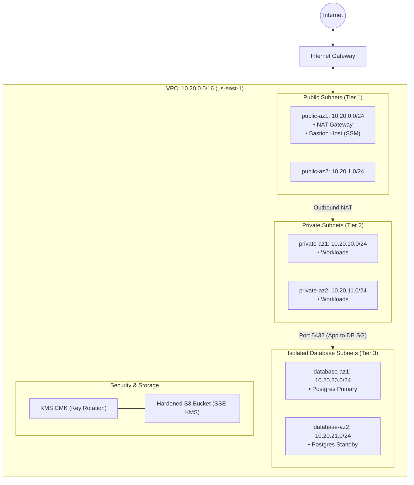

# AWS Secure Multi-AZ Infrastructure (Terraform)

[](https://github.com/vikasrao-ops/aws-secure-infrastructure/actions)
[](LICENSE)
[](https://aws.amazon.com/)
[](https://github.com/vikasrao-ops)

A modular, zero-trust Terraform implementation of a production-hardened **AWS Multi-AZ Infrastructure**. Demonstrates practical hands-on engineering expertise in 3-tier VPC network isolation, keyless AWS Systems Manager (SSM) management, customer-managed KMS encryption, and least-privilege IAM security.

> **Engineering Note:** This repository is an independent hands-on architectural project demonstrating AWS cloud engineering skills, distinct from enterprise Azure professional employment.

---

## 1. Problem Statement

Deploying workloads to AWS without structured network segmentation exposes internal databases to the public internet, increases attack surface via exposed SSH port 22, and risks data exposure due to unencrypted S3 storage.

This repository provides an automated, auditable, and immutable Terraform codebase provisioning a compliant 3-tier network with keyless management, IMDSv2 protection, and encrypted storage.

---

## 2. Architecture



---

## 3. Prerequisites

* **Terraform CLI**: Version `>= 1.5.0`
* **AWS CLI**: Version `>= 2.15.0`
* **AWS Account Credentials**: Configured via `aws configure` or IAM Identity Center.
* **Make** (optional)

---

## 4. Technology Stack

* **Infrastructure as Code:** HashiCorp Terraform (`aws` provider `>= 5.40`)
* **Cloud Platform:** Amazon Web Services (AWS)
* **Networking:** Multi-AZ VPC, NAT Gateway, Route Tables, Security Groups
* **Compute & Management:** EC2 Amazon Linux 2023, AWS Systems Manager (SSM) Session Manager
* **Storage & Encryption:** AWS S3, AWS KMS (Customer Managed Keys)
* **Observability:** Amazon CloudWatch Metric Alarms

---

## 5. Installation & Local Setup

1. **Clone the repository:**
   ```bash
   git clone https://github.com/vikasrao-ops/aws-secure-infrastructure.git
   cd aws-secure-infrastructure
   ```

2. **Authenticate with AWS:**
   ```bash
   aws sts get-caller-identity
   ```

3. **Initialize Terraform:**
   ```bash
   cd infrastructure
   terraform init
   ```

---

## 6. Implementation & Deployment Guide

1. **Configure parameters:**
   ```bash
   cp ../examples/terraform.tfvars.example terraform.tfvars
   ```

2. **Validate and preview execution plan:**
   ```bash
   terraform fmt -check
   terraform validate
   terraform plan -out=tfplan
   ```

3. **Provision the infrastructure:**
   ```bash
   terraform apply tfplan
   ```

4. **Connect to Bastion Host without SSH Keys (via SSM):**
   ```bash
   aws ssm start-session --target <BASTION_INSTANCE_ID>
   ```

---

## 7. Expected Output

```text
Apply complete! Resources: 22 added, 0 changed, 0 destroyed.

Outputs:
bastion_instance_id = "i-09ab71e823fca102b"
database_subnet_ids = [
  "subnet-0123abc456def7890",
  "subnet-0987fed654cba3210",
]
private_subnet_ids = [
  "subnet-0a1b2c3d4e5f67890",
  "subnet-0f9e8d7c6b5a43210",
]
public_subnet_ids = [
  "subnet-01122334455667788",
  "subnet-08877665544332211",
]
s3_bucket_name = "secure-core-prod-data-a1b2c3"
vpc_id = "vpc-03918a287c10bcf2e"
```

---

## 8. Security Considerations

* **Keyless Management (No Port 22):** Inbound SSH is completely blocked in the security group. Management sessions authenticate via AWS IAM using Systems Manager Session Manager.
* **Isolated Database Tier:** Database subnets have zero route table association with the internet or NAT gateway.
* **IMDSv2 Mandatory:** EC2 instance metadata requires session tokens (`http_tokens = "required"`), preventing SSRF attacks.
* **Customer Managed Key (CMK):** S3 bucket objects and EBS root volumes are encrypted using KMS keys with annual automatic rotation.

---

## 9. Cost Considerations

* **NAT Gateway:** A single NAT Gateway is deployed to balance cost (\$0.045/hour) and outbound capability in development/staging. In production, Multi-AZ NAT Gateways can be enabled.
* **EC2 Bastion:** Runs on cost-effective `t3.micro` instance eligible for AWS Free Tier.
* **S3 Lifecycle:** Automatically transitions older objects to standard Infrequent Access.

---

## 10. Cleanup & Teardown

To deprovision resources and eliminate cloud spend:

```bash
cd infrastructure
terraform destroy -auto-approve
```

---

## 11. Known Limitations

* Deploys a single NAT Gateway across AZs to optimize costs; production high-resilience tiers require one NAT Gateway per Availability Zone.

---

## 12. Future Improvements

* [ ] Add Auto Scaling Group (ASG) and Application Load Balancer (ALB) module for auto-healing workloads.
* [ ] Implement AWS VPC Flow Logs streaming to CloudWatch Logs with Athena query examples.
* [ ] Provision AWS GuardDuty and Security Hub compliance benchmark automation.

---

<div align="center">
  <sub>Maintained by <a href="https://github.com/vikasrao-ops">Vikas Rao</a> • Part of the Multi-Cloud DevOps Portfolio</sub>
</div>

