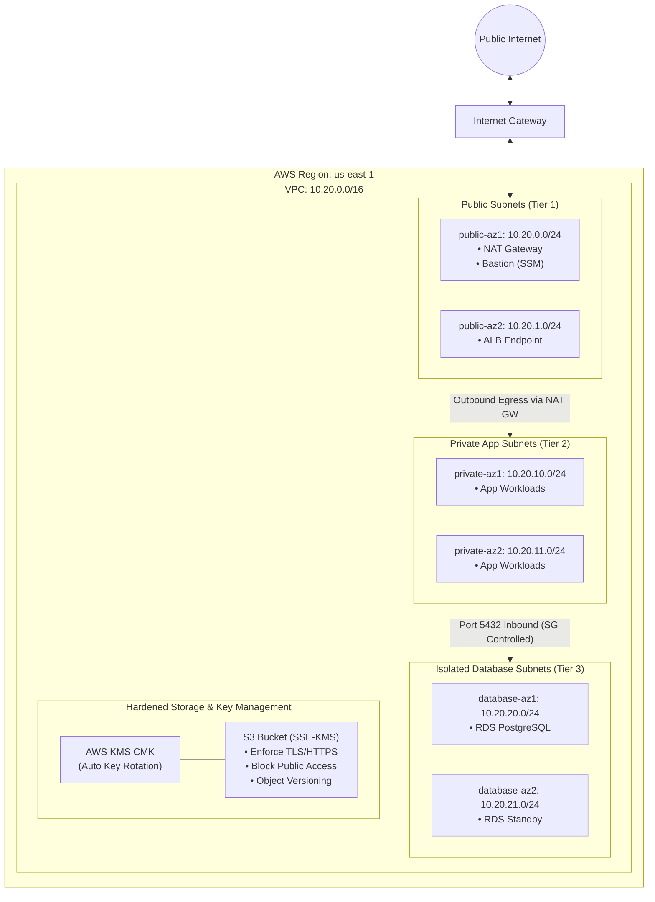

# Architecture Specification: AWS Secure Multi-AZ Infrastructure

## 1. Network Topology

The AWS Secure Infrastructure utilizes a 3-tier Multi-AZ Virtual Private Cloud (VPC) design across two Availability Zones, enforcing complete network isolation between the public edge, private applications, and sensitive database storage.

## 2. Security Boundaries & Zero-Trust Features

* **SSM Session Manager:** Eliminates public SSH port 22 access. Operators connect via IAM credentials through encrypted AWS Systems Manager tunnels.
* **Isolated Database Tier:** Database subnets have no route table association to Internet Gateways or NAT Gateways, preventing exfiltration or direct ingress.
* **IMDSv2 Enforcement:** EC2 metadata service requires session tokens (`http_tokens = "required"`), preventing SSRF credential theft.
* **Customer Managed KMS Encryption:** All data at rest in S3 and EBS is protected with rotating customer-managed KMS keys.

