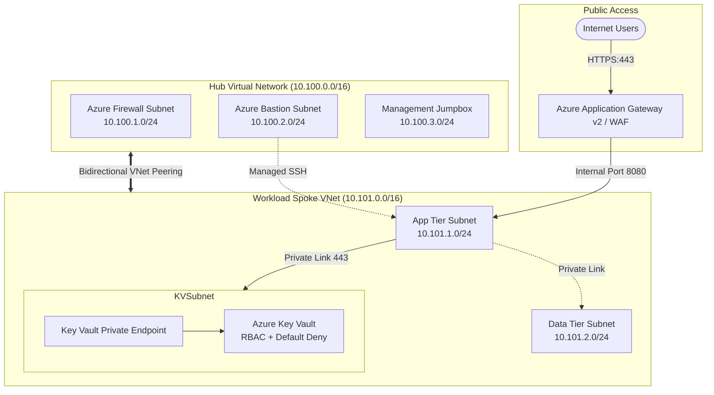

# Azure DevSecOps Landing Zone

[](https://www.terraform.io/)
[](https://azure.microsoft.com/)
[](https://azure.microsoft.com/services/devops/)
[](#security-architecture)

A production-ready Microsoft Azure Hub-and-Spoke Landing Zone built with modular Terraform and integrated with an end-to-end DevSecOps CI/CD release pipeline in Azure DevOps. Implements zero-trust isolation, private endpoints, WAF v2 ingress, and automated security scanning.

---

## Architecture Overview



---

## Core Security & Architectural Highlights

- **Hub-and-Spoke Isolation:** Segregates perimeter ingress and shared operational services (Firewall, Bastion, Jumpbox) from workload runtimes.
- **Zero Public IP Compute:** Application workloads run strictly inside private subnets without public IPv4 exposure.
- **Private Link Data Protection:** Azure Key Vault connects over dedicated private IP addresses (`privatelink.vaultcore.azure.net`) with default network denial rules.
- **Shift-Left Security Pipeline:** Checkov scans Terraform code on every Pull Request, blocking non-compliant changes before infrastructure plans execute.

---

## Code Highlights

### 1. Terraform Hub-and-Spoke Peering & Network Isolation
```hcl
# Bidirectional VNet Peering linking Central Hub and Workload Spoke
resource "azurerm_virtual_network_peering" "hub_to_spoke" {
  name                         = "peer-hub-to-spoke"
  resource_group_name          = var.hub_rg_name
  virtual_network_name         = var.hub_vnet_name
  remote_virtual_network_id    = azurerm_virtual_network.spoke.id
  allow_virtual_network_access = true
  allow_forwarded_traffic      = true
}

resource "azurerm_virtual_network_peering" "spoke_to_hub" {
  name                         = "peer-spoke-to-hub"
  resource_group_name          = azurerm_resource_group.spoke.name
  virtual_network_name         = azurerm_virtual_network.spoke.name
  remote_virtual_network_id    = var.hub_vnet_id
  allow_virtual_network_access = true
  allow_forwarded_traffic      = true
}
```

### 2. Zero-Trust Azure Key Vault Private Endpoint
```hcl
resource "azurerm_key_vault" "vault" {
  name                       = "kv-${var.project_name}-${var.environment}"
  location                   = var.location
  resource_group_name        = var.resource_group_name
  tenant_id                  = data.azurerm_client_config.current.tenant_id
  sku_name                   = "standard"
  soft_delete_retention_days = 90
  purge_protection_enabled   = true
  enable_rbac_authorization  = true

  network_acls {
    bypass         = "AzureServices"
    default_action = "Deny"
  }
}
```

### 3. Azure DevOps Multi-Stage DevSecOps Pipeline (`azure-pipelines.yml`)
```yaml
stages:
  - stage: SecurityValidation
    displayName: 'Lint & IaC Security'
    jobs:
      - job: StaticScan
        steps:
          - script: terraform fmt -check -recursive
            displayName: 'Enforce Terraform Formatting'
          - script: checkov -d infrastructure --framework terraform
            displayName: 'Run Checkov CIS Security Audit'

  - stage: TerraformPlan
    displayName: 'Speculative Plan'
    dependsOn: SecurityValidation
    jobs:
      - job: GeneratePlan
        steps:
          - task: AzureCLI@2
            inputs:
              azureSubscription: $(azureServiceConnection)
              scriptType: 'bash'
              inlineScript: terraform plan -out=tfplan.binary

  - stage: ProductionApply
    displayName: 'Deploy Landing Zone'
    dependsOn: TerraformPlan
    condition: and(succeeded(), eq(variables['Build.SourceBranch'], 'refs/heads/main'))
    jobs:
      - deployment: ApplyGate
        environment: 'landingzone-production'
```

---

## Repository Directory Tree

```
.
├── azure-pipelines/
│   └── azure-pipelines.yml         # DevSecOps multi-stage release pipeline
├── examples/
│   └── terraform.tfvars.example    # Variable sample file
├── infrastructure/
│   ├── main.tf                     # Root orchestrator
│   ├── variables.tf                # Input parameters
│   ├── outputs.tf                  # Exported IDs & endpoints
│   ├── versions.tf                 # Provider & backend constraints
│   └── modules/
│       ├── hub-network/            # Hub VNet, Firewall, Bastion, NSGs
│       ├── spoke-network/          # Spoke VNet, subnets, peering
│       ├── security-vault/         # Key Vault, Private Endpoint, DNS
│       └── waf-gateway/            # Application Gateway WAF v2
└── README.md
```

---

## Deployment Guide

```bash
cd infrastructure
terraform init
terraform plan -var-file="../examples/terraform.tfvars.example" -out=tfplan
terraform apply tfplan
```
