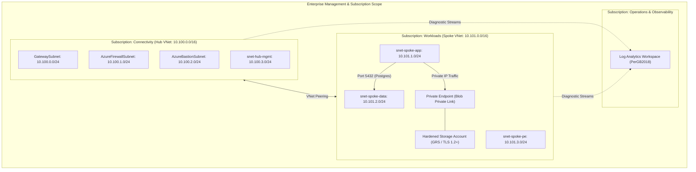

# Azure Enterprise Landing Zone (Terraform)

[](https://github.com/vikasrao-ops/azure-enterprise-landing-zone/actions)
[](LICENSE)
[](https://azure.microsoft.com/)
[](https://www.terraform.io/)

Production-grade, modular Terraform implementation of an enterprise Microsoft Azure landing zone following the **Cloud Adoption Framework (CAF)**. Incorporates Hub-and-Spoke network isolation, Azure Private Endpoints, centralized Log Analytics, and Azure Policy compliance.

---

## 1. Problem Statement

Enterprises scaling workloads on Microsoft Azure frequently face configuration drift, unmonitored egress traffic, public exposure of data stores, and inconsistent resource tagging. 

This repository solves these challenges by providing an automated, auditable, and immutable Terraform codebase that deploys a secured foundation with strict network boundaries, zero direct internet ingress to databases, and automated policy governance.

---

## 2. Architecture



---

## 3. Prerequisites

* **Terraform CLI**: Version `>= 1.5.0`
* **Azure CLI**: Version `>= 2.50.0`
* **Azure Subscription**: Contributor and User Access Administrator permissions on the target scope.
* **Make** (optional, for local task automation)

---

## 4. Technology Stack

* **Infrastructure as Code:** HashiCorp Terraform (`azurerm` provider `>= 3.90`)
* **Cloud Platform:** Microsoft Azure
* **Networking:** Azure Virtual Network, VNet Peering, Private Endpoints, Network Security Groups (NSGs)
* **Governance & Policy:** Azure Policy Definitions (`Allowed locations`), RBAC, Resource Tagging
* **Observability:** Azure Log Analytics Workspace
* **Security & CI:** Bridgecrew Checkov, GitHub Actions

---

## 5. Installation & Local Setup

1. **Clone the repository:**
   ```bash
   git clone https://github.com/vikasrao-ops/azure-enterprise-landing-zone.git
   cd azure-enterprise-landing-zone
   ```

2. **Authenticate with Azure:**
   ```bash
   az login
   az account set --subscription "<YOUR_SUBSCRIPTION_ID>"
   ```

3. **Initialize Terraform:**
   ```bash
   cd infrastructure
   terraform init
   ```

---

## 6. Implementation & Deployment Guide

1. **Configure input variables:**
   ```bash
   cp ../examples/terraform.tfvars.example terraform.tfvars
   # Modify values in terraform.tfvars as required
   ```

2. **Validate syntax and run execution plan:**
   ```bash
   terraform fmt -check
   terraform validate
   terraform plan -out=landing-zone.tfplan
   ```

3. **Provision the landing zone:**
   ```bash
   terraform apply landing-zone.tfplan
   ```

---

## 7. Expected Output

Upon successful deployment, Terraform will output resource IDs and private addresses:

```text
Apply complete! Resources: 14 added, 0 changed, 0 destroyed.

Outputs:
hub_vnet_id = "/subscriptions/.../resourceGroups/rg-connectivity-hub-prod/providers/Microsoft.Network/virtualNetworks/vnet-hub-core"
log_analytics_workspace_id = "/subscriptions/.../resourceGroups/rg-operations-mgmt-prod/providers/Microsoft.OperationalInsights/workspaces/log-core-telemetry"
spoke_vnet_id = "/subscriptions/.../resourceGroups/rg-workload-spoke-prod/providers/Microsoft.Network/virtualNetworks/vnet-spoke-workload"
storage_account_name = "stcoreprodabc123"
storage_private_endpoint_ip = "10.101.3.4"
```

---

## 8. Security Considerations

* **Zero-Trust Network Perimeter:** Direct public access to the storage account is disabled (`public_network_access_enabled = false`). All traffic resolves over private IPs via Azure Private DNS Zone.
* **Micro-segmentation:** Default-deny NSG rules isolate the data tier from direct public exposure and lateral movement.
* **Policy Guardrails:** Azure Policy restricts resource deployments exclusively to approved corporate regions (`eastus`, `eastus2`).

---

## 9. Cost Considerations

* **Log Analytics Workspace:** Billed per GB ingested (`PerGB2018` SKU). Retention capped at 30-60 days to prevent runaway storage expenses.
* **VNet Peering:** Inter-VNet ingress/egress is billed at approximately \$0.01 per GB in the same region.
* **Private Endpoints:** Standard Azure Private Link hourly fee (~0.01/hr per endpoint) plus data processing.

---

## 10. Cleanup & Teardown

To deprovision all provisioned infrastructure and prevent ongoing Azure charges:

```bash
cd infrastructure
terraform destroy -auto-approve
```

---

## 11. Known Limitations

* Deploys single-region Hub-and-Spoke. For active-active multi-region resiliency, pair with secondary region spoke peering and Azure Traffic Manager / Azure Front Door.
* Azure Firewall and VPN Gateway subnet definitions are provisioned; deploying the full Azure Firewall appliance requires additional allocation based on corporate egress requirements.

---

## 12. Future Improvements

* [ ] Integrate HashiCorp Vault Azure Secret Engine for automated dynamic credentials.
* [ ] Implement Azure Bastion Standard with native host tunneling.
* [ ] Expand Azure Policy assignments with custom CIS Azure Foundations initiative benchmarks.

---

<div align="center">
  <sub>Maintained by <a href="https://github.com/vikasrao-ops">Vikas Rao</a> • Part of the Multi-Cloud DevOps Portfolio</sub>
</div>

