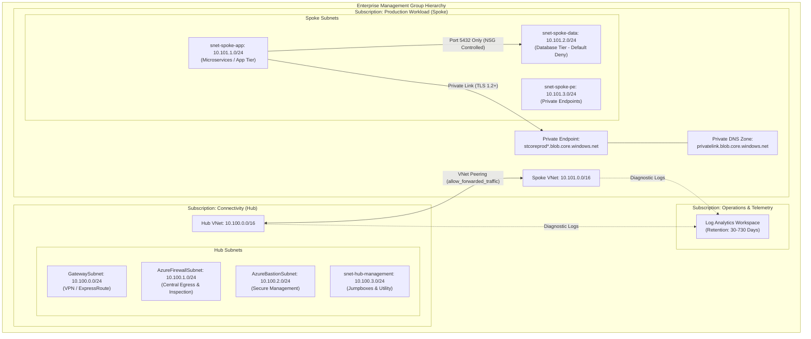

# Architecture Specification: Azure Enterprise Landing Zone

## 1. Topological Overview

The Azure Enterprise Landing Zone implements the Microsoft Cloud Adoption Framework (CAF) Hub-and-Spoke topology. It establishes an enterprise foundation ensuring isolation, centralized traffic egress, centralized security auditing, and least-privilege boundary enforcement.

## 2. Network Segmentation & Security Controls

- **Zero Direct Inbound Internet:** No public IP addresses are assigned to spoke workloads or database interfaces.
- **Micro-segmentation via NSGs:**
  - `nsg-hub-management`: Restricts port 22 access strictly to the Azure Bastion CIDR block.
  - `nsg-spoke-app`: Restricts inbound traffic strictly to verified Hub VNet prefixes on HTTPS 443.
  - `nsg-spoke-data`: Enforces database port access (e.g., PostgreSQL 5432) exclusively from `snet-spoke-app`.
- **Private DNS Link Integration:** Resolves Azure PaaS endpoints internally, avoiding internet-routed FQDN resolution.

