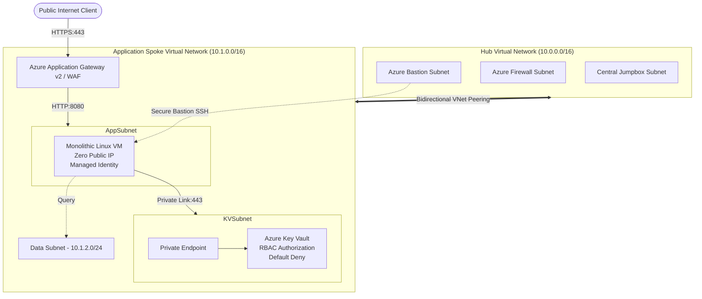

# Azure Landing Zone & Secure Monolithic Application Deployment

[](https://www.terraform.io/)
[](https://azure.microsoft.com/)
[](https://azure.microsoft.com/services/devops/)
[](#zero-trust-architecture)

An enterprise-grade reference architecture for hosting a high-availability monolithic enterprise application inside a Microsoft Azure Hub-and-Spoke Landing Zone. Designed for compliance, zero-public-IP compute isolation, Azure Key Vault secrets integration via Managed Identity, and automated release gates in Azure DevOps.

---

## 1. Architectural Highlights



- **Network Isolation:** Compute runs in a private subnet with zero direct Internet ingress. Ingress is exclusively brokered by Azure Application Gateway WAF v2.
- **Identity-Driven Access:** System-Assigned Managed Identity retrieves connection strings and encryption keys from Azure Key Vault without storing static credentials in application configs.
- **Private Link Integration:** Azure Key Vault communicates over a Private Endpoint within a dedicated subnet, entirely bypassing public DNS endpoints.
- **Automated CI/CD:** Azure DevOps multi-stage YAML pipelines govern infrastructure validation (`terraform plan`/`apply` with manual approvals) and monolithic application deployment.

---

## 2. Network Topology & Subnet Schema

| Tier | Subnet Name | CIDR Block | NSG Purpose |
| :--- | :--- | :--- | :--- |
| **Hub Gateway** | `AzureFirewallSubnet` | `10.0.1.0/24` | Reserved for centralized egress inspection |
| **Hub Access** | `AzureBastionSubnet` | `10.0.2.0/24` | Managed browser-based administrative SSH |
| **Hub Mgmt** | `snet-hub-mgmt-prod` | `10.0.3.0/24` | Management agents and tooling jumpbox |
| **Spoke Ingress**| `snet-monolith-appgw-prod`| `10.1.4.0/24` | Public WAF frontend ingress listener |
| **Spoke App** | `snet-monolith-app-prod` | `10.1.1.0/24` | Monolithic compute; accepts only port 8080 from WAF |
| **Spoke Vault** | `snet-monolith-keyvault-prod`| `10.1.3.0/24` | Key Vault Private Link endpoint |
| **Spoke Data** | `snet-monolith-data-prod`| `10.1.2.0/24` | Storage and relational database endpoints |

---

## 3. Directory Layout

```
.
├── azure-pipelines/
│   ├── azure-pipelines-infra.yml   # Multi-stage Terraform CI/CD pipeline
│   └── azure-pipelines-app.yml     # Application packaging and VM release pipeline
├── examples/
│   └── terraform.tfvars.example    # Parameter configurations
├── infrastructure/
│   ├── main.tf                     # Root orchestration wiring modules
│   ├── variables.tf                # Input parameter definitions
│   ├── outputs.tf                  # Exported IPs, resource IDs, endpoints
│   ├── versions.tf                 # AzureRM provider & backend state constraints
│   └── modules/
│       ├── hub-network/            # Hub VNet, Bastion, subnets, NSGs
│       ├── spoke-network/          # Spoke VNet, subnets, peering configuration
│       ├── key-vault/              # Key Vault with Private Endpoint & RBAC
│       ├── monolithic-compute/     # Linux VM, Managed Identity, cloud-init
│       ├── application-gateway/    # WAF v2, routing rules, health probes
│       └── monitoring/             # Log Analytics & diagnostic settings
└── src/
    └── monolith-app/               # Application service with Key Vault client
        ├── server.js               # Service entrypoint
        ├── package.json            # Node runtime dependencies
        └── systemd/                # Linux systemd service unit
```

---

## 4. Azure DevOps Pipeline Architecture

The release workflow is split into two coordinated pipelines:

1. **`azure-pipelines-infra.yml`**:
   - `ValidateAndLint`: Runs `terraform fmt`, `terraform validate`, and Checkov security scanning.
   - `TerraformPlan`: Connects to Azure Service Principal and creates a binary speculative plan.
   - `TerraformApply`: Triggers on `main` branch merges, requiring approvals on the `landing-zone-production` environment before applying.

2. **`azure-pipelines-app.yml`**:
   - Compiles and bundles application assets into a release artifact.
   - Invokes Azure CLI Run Command to update the service without opening SSH port 22 to the public internet.

---

## 5. Deployment Instructions

### Prerequisites
- Azure CLI `>= 2.50.0`
- Terraform `>= 1.5.0`
- Configured Azure Subscription with Owner or Contributor permissions

### Provisioning
```bash
cd infrastructure
terraform init -backend-config="resource_group_name=<STATE_RG>" \
               -backend-config="storage_account_name=<STATE_STORAGE>" \
               -backend-config="container_name=tfstate" \
               -backend-config="key=monolith.tfstate"

terraform plan -var-file="../examples/terraform.tfvars.example" -out=tfplan
terraform apply tfplan
```
