# DevSecOps Automation Platform

[](https://github.com/vikasrao-ops/devsecops-platform/actions)
[](LICENSE)
[](https://aquasecurity.github.io/trivy/)
[](https://spdx.dev/)

An end-to-end, shift-left DevSecOps automation pipeline engineered using GitHub Actions, Gitleaks, Semgrep SAST, Aqua Trivy, and Anchore Syft. Features a security-hardened, multi-stage Python microservice.

---

## 1. Problem Statement

Modern software supply chains are vulnerable to credential leakage, insecure base images, open-source CVE exploitation, and lack of component provenance. Deploying applications without automated security validation introduces critical vulnerabilities into production environments.

This repository provides an automated security pipeline that enforces zero-trust guardrails across the entire delivery lifecycle, stopping security defects before containerized applications reach staging or production clusters.

---

## 2. Architecture

```mermaid
flowchart LR
    subgraph Workstation ["Developer Workstation"]
        Dev["Developer Commit"] --> PreCommit["Gitleaks Secret Scan"]
    end

    subgraph Pipeline ["GitHub Actions DevSecOps Pipeline"]
        PreCommit --> Stage1["1. Gitleaks Scan"]
        Stage1 --> Stage2["2. Unit Tests & SAST (Semgrep)"]
        Stage2 --> Stage3["3. Multi-Stage Docker Build (Non-root)"]
        Stage3 --> Stage4["4. Trivy Vulnerability Scan"]
        Stage4 --> Stage5["5. Syft SBOM Attestation"]
        Stage5 --> Stage6["6. Gated Release Approval"]
    end

    subgraph Runtime ["Cluster Runtime"]
        Stage6 --> K8s["Kubernetes / Cloud Production"]
    end
```



---

## 3. Prerequisites

* **Docker Engine**: Version `>= 24.0` (for local image builds and runs)
* **Python**: Version `>= 3.11` (for local unit testing)
* **Trivy CLI** (optional, for local vulnerability scanning)
* **Make** (optional, for automation targets)

---

## 4. Technology Stack

* **CI/CD Platform:** GitHub Actions
* **Application Framework:** Python 3.12 / Flask / Gunicorn
* **Secret Detection:** Gitleaks Action v2
* **Static Analysis (SAST):** Semgrep Static Analyzer
* **Container Hardening:** Multi-stage Dockerfile, Alpine runtime, unprivileged user `UID 10001`
* **Vulnerability Scanning:** Aqua Security Trivy
* **Supply Chain Security:** Anchore Syft (SPDX standard SBOM)

---

## 5. Installation & Local Setup

1. **Clone the repository:**
   ```bash
   git clone https://github.com/vikasrao-ops/devsecops-platform.git
   cd devsecops-platform
   ```

2. **Set up local virtual environment & install requirements:**
   ```bash
   python -m venv venv
   source venv/bin/activate  # On Windows: .\venv\Scripts\Activate.ps1
   pip install -r src/requirements.txt
   ```

3. **Execute local unit tests:**
   ```bash
   cd src
   python -m unittest test_app.py
   ```

---

## 6. Implementation & Container Run

1. **Build the hardened container image:**
   ```bash
   docker build -t devsecops-secure-api:latest src/
   ```

2. **Run the container with non-root security context:**
   ```bash
   docker run -d --rm -p 8080:8080 --name secure-api devsecops-secure-api:latest
   ```

3. **Verify running endpoints and HTTP security headers:**
   ```bash
   curl -i http://localhost:8080/
   curl -i http://localhost:8080/healthz
   ```

---

## 7. Expected Output

API response containing security headers:

```http
HTTP/1.1 200 OK
Content-Type: application/json
X-Content-Type-Options: nosniff
X-Frame-Options: DENY
X-XSS-Protection: 1; mode=block
Strict-Transport-Security: max-age=31536000; includeSubDomains

{
  "framework": "flask",
  "service": "devsecops-secure-api",
  "status": "operational",
  "version": "1.0.0"
}
```

---

## 8. Security Considerations

* **Non-Root Execution:** Container runs strictly as `USER 10001:10001` with no shell access (`/sbin/nologin`).
* **Minimal Base Image:** Uses Alpine Linux, removing unnecessary build utilities and reducing the CVE attack surface by 90% compared to standard OS images.
* **HTTP Hardening:** Enforces `Strict-Transport-Security`, `X-Frame-Options: DENY`, and `X-Content-Type-Options: nosniff`.
* **Zero Secrets in Git:** Automated Gitleaks verification blocks committed passwords, tokens, or private keys.

---

## 9. Cost Considerations

* **Compute:** Runs on free-tier GitHub Actions runners (`ubuntu-latest`).
* **Tooling:** 100% open-source toolchain (Gitleaks, Semgrep Community, Trivy, Syft) with zero licensing costs.

---

## 10. Cleanup & Teardown

To stop the local container:

```bash
docker stop secure-api
```

---

## 11. Known Limitations

* Image signing step currently outputs local SPDX SBOM artifacts; integration with Sigstore Cosign keyless signing requires a connected OIDC identity provider.

---

## 12. Future Improvements

* [ ] Implement Sigstore Cosign container image signing and in-toto provenance attestations.
* [ ] Integrate Kyverno / OPA Gatekeeper policies into the deployment gate to reject unsigned images at cluster admission.
* [ ] Add DAST (Dynamic Application Security Testing) via OWASP ZAP baseline scan.

---

<div align="center">
  <sub>Maintained by <a href="https://github.com/vikasrao-ops">Vikas Rao</a> • Part of the Multi-Cloud DevOps Portfolio</sub>
</div>

