# Architecture Specification: DevSecOps Automation Platform

## 1. Pipeline Topology

The DevSecOps Platform incorporates continuous security verification at every phase of the developer lifecycle (Shift-Left). Security gates are automated directly within GitHub Actions, preventing insecure commits, vulnerable dependencies, and untracked container images from entering production.

```mermaid
flowchart LR
    subgraph DeveloperWorkstation ["Developer Stage"]
        Commit["git commit"] --> PreCommit["Local Pre-commit Hook<br/>(Gitleaks + Flake8)"]
    end

    subgraph CI_Pipeline ["GitHub Actions DevSecOps Pipeline"]
        PreCommit --> Push["git push / PR"]
        Push --> Stage1["Stage 1: Secret Scan<br/>(Gitleaks Action)"]
        Stage1 --> Stage2["Stage 2: Code Quality & SAST<br/>(Python Unit Tests + Semgrep)"]
        Stage2 --> Stage3["Stage 3: Container Build & Hardening<br/>(Multi-Stage Dockerfile)"]
        Stage3 --> Stage4["Stage 4: Vulnerability Scanning<br/>(Aqua Trivy Image Scan)"]
        Stage4 --> Stage5["Stage 5: Supply Chain Security<br/>(Syft SBOM Generation)"]
        Stage5 --> Stage6["Stage 6: Security Gate<br/>(Automated Release Approval)"]
    end

    subgraph CD_Target ["Deployment Environment"]
        Stage6 --> Registry["Hardened Container Registry"]
        Registry --> Cluster["Kubernetes / Cloud Runtime"]
    end
```

## 2. Shift-Left Security Tooling Matrix

| Phase | Tool | Role | Threshold / Gate Rule |
| :--- | :--- | :--- | :--- |
| **Secrets** | Gitleaks | Scans full commit history for credentials and API keys | Fails build if any unmasked secret is detected |
| **SAST** | Semgrep | Static application analysis for injection & OWASP Top 10 | Security audit warnings surfaced on PR review |
| **Testing** | Pytest / Unittest | Verifies application functionality and HTTP security headers | 100% pass rate mandatory |
| **Image Scan**| Trivy | Scans container OS layers and Python wheels for CVEs | Blocks release on unpatched `CRITICAL` vulnerabilities |
| **Supply Chain**| Syft | Generates SPDX Software Bill of Materials (SBOM) | Machine-readable dependency catalog published as artifact |

