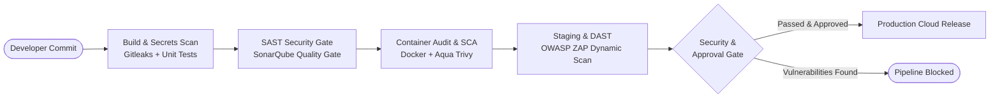

# Enterprise CI/CD & DevSecOps Pipeline Automation

[](https://azure.microsoft.com/services/devops/)
[](https://www.sonarqube.org/)
[](https://trivy.dev/)
[](https://www.zaproxy.org/)

An enterprise-ready DevSecOps pipeline implementation built for Azure DevOps. Enforces Shift-Left security validation by embedding Secret Detection, Static Application Security Testing (SAST), Container Software Composition Analysis (SCA), and Dynamic Application Security Testing (DAST) directly into pull requests and release stages.

---

## 1. DevSecOps Pipeline Flow



---

## 2. Integrated Security Gates

| Security Domain | Tool | Gate Evaluation Criteria | Action on Failure |
| :--- | :--- | :--- | :--- |
| **Secret Detection** | Gitleaks | Regex detection of API keys, tokens, and private keys | **Build Blocked** immediately in Stage 1 |
| **Static Code Analysis (SAST)** | SonarQube | Zero High/Critical security vulnerabilities; Maintainability Grade `A` | **Quality Gate Fails**, halts pipeline progression |
| **Container & SCA (CVEs)** | Aqua Trivy | Vulnerability scan of base images and npm lockfile dependencies | **Exit code 1** on `CRITICAL` or `HIGH` vulnerabilities |
| **Dynamic Analysis (DAST)** | OWASP ZAP | Active attack probe on staging HTTP listener (XSS, Injection, CSP) | Generates HTML audit report; alerts on High risk |
| **Release Promotion** | Azure DevOps | Manual sign-off required on production environment | Gated deployment promotion |

---

## 3. Repository Structure

```
.
├── azure-pipelines.yml             # Master multi-stage Azure DevOps YAML pipeline
├── sonar-project.properties        # SonarQube quality gate thresholds and inclusions
├── trivy.yaml                      # Aqua Trivy scanner rules and severity triggers
├── zap-rules.tsv                   # OWASP ZAP dynamic scanning baseline rule thresholds
├── .gitleaks.toml                  # Secret scanner allowlists and regex configurations
├── templates/                      # Reusable step templates
│   ├── steps-secrets-scan.yml      # Gitleaks execution step
│   ├── steps-sonarqube-sast.yml    # SonarQube prepare, analyze, publish steps
│   ├── steps-trivy-scan.yml        # Trivy filesystem and container scan step
│   └── steps-owasp-zap.yml         # OWASP ZAP Dockerized DAST step
└── src/
    └── api-app/                    # Containerized Node.js API service
        ├── Dockerfile              # Multi-stage non-root Alpine container
        ├── server.js               # Service with secure HTTP headers
        ├── package.json            # Application dependencies and test scripts
        └── test/                   # Automated regression test suite
```

---

## 4. Azure DevOps Configuration Guide

### 1. Service Connections
- **SonarQube Endpoint:** Create a Service Connection of type `SonarQube` named `SonarQube-Service-Endpoint` pointing to your SonarQube or SonarCloud server instance.
- **Docker Registry:** Configure your container registry service connection (`Azure Container Registry` or `Docker Hub`).

### 2. Environment Gates
- Navigate to **Pipelines > Environments** in Azure DevOps.
- Configure `staging-environment` for ephemeral dynamic scanning.
- Configure `production-cloud-environment` with required reviewers and approval gates.

---

## 5. Local Execution Commands

Run scans locally prior to triggering the remote pipeline:

```bash
# 1. Secret scanning
gitleaks detect --source=. --verbose

# 2. Filesystem vulnerability scan
trivy fs --severity HIGH,CRITICAL src/api-app/

# 3. Build & Scan Container
docker build -t enterprise-api:local src/api-app/
trivy image --severity HIGH,CRITICAL enterprise-api:local

# 4. Dynamic DAST Scan against running container
docker run -d --name local-test -p 8080:8080 enterprise-api:local
docker run --network="host" -v $(pwd):/zap/wrk/:rw ghcr.io/zaproxy/zaproxy:stable zap-baseline.py -t http://localhost:8080
docker rm -f local-test
```
