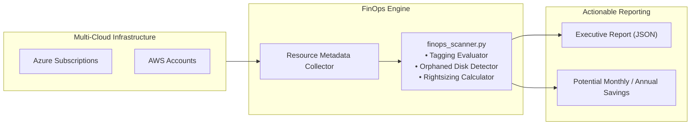

# FinOps Cloud Cost Governance & Waste Scanner

[](https://github.com/vikasrao-ops/finops-governance/actions)
[](LICENSE)
[](https://python.org)
[](https://www.finops.org/)

An automated multi-cloud cost optimization and governance scanner built in Python. Audits resource inventories across Azure and AWS for tagging compliance, detects orphaned and idle cloud assets (unattached disks, idle public IPs), and generates actionable dollar-savings recommendations.

---

## 1. Problem Statement

Uncontrolled cloud sprawl, orphaned disks from deleted virtual machines, abandoned public IP reservations, and unallocated shared infrastructure quietly inflate monthly cloud bills by thousands of dollars.

This repository provides an automated FinOps scanning engine that identifies waste, calculates annualized dollar savings, and enforces tagging compliance across multi-cloud environments.

---

## 2. Architecture



---

## 3. Prerequisites

* **Python**: Version `>= 3.10`
* **JSON Inventory File**: Exported from Azure Resource Graph (`az graph query`) or AWS Resource Explorer.
* **Make** (optional)

---

## 4. Technology Stack

* **Language:** Python 3.12 (Standard Library + CLI)
* **Testing:** Python `unittest` framework
* **Target Platforms:** Microsoft Azure, Amazon Web Services
* **Output Standards:** Structured JSON and executive reporting tables

---

## 5. Installation & Local Setup

1. **Clone the repository:**
   ```bash
   git clone https://github.com/vikasrao-ops/finops-governance.git
   cd finops-governance
   ```

2. **Run test suite to verify scanner logic:**
   ```bash
   cd src
   python -m unittest test_finops_scanner.py
   ```

---

## 6. Implementation & Execution Guide

1. **Run scanner against sample multi-cloud inventory:**
   ```bash
   python src/finops_scanner.py \
     --inventory examples/sample-inventory.json \
     --output report.json
   ```

2. **Inspect generated savings report:**
   ```bash
   cat report.json
   ```

---

## 7. Expected Output

Executive output displaying compliance rates and projected dollar savings:

```json
{
  "summary": {
    "total_resources_scanned": 4,
    "tagging_compliance_percentage": 50.0,
    "total_monthly_waste_identified_usd": 83.65,
    "annualized_projected_savings_usd": 1003.8
  },
  "tagging_violations": [
    {
      "resource_id": "vol-08492048291a",
      "resource_type": "aws_ebs_volume",
      "compliant": false,
      "missing_tags": ["CostCenter"]
    }
  ],
  "cost_optimization_findings": [
    {
      "resource_id": "vol-08492048291a",
      "type": "aws_ebs_volume",
      "reason": "Unattached persistent storage disk",
      "monthly_savings_usd": 20.0
    },
    {
      "resource_id": "vm-batch-worker-04",
      "type": "azure_vm",
      "reason": "Severely underutilized compute (Avg CPU 1.8%) - Recommend 50% downsize",
      "monthly_savings_usd": 60.0
    }
  ]
}
```

---

## 8. Security Considerations

* **Read-Only Permissions:** The scanner operates strictly in a read-only metadata inspection mode; it never possesses write or destructive privileges.
* **Zero Credential Storage:** Connects via ambient Azure Managed Identity or AWS IAM Role without storing long-lived credentials.

---

## 9. Cost Considerations

* **Serverless Execution:** Runs as an on-demand CLI or container with zero idle infrastructure cost.

---

## 10. Cleanup & Teardown

To remove local test output:

```bash
rm -f report.json
```

---

## 11. Known Limitations

* Current inventory models cover compute instances, managed/EBS disks, and public IPs; database rightsizing requires additional telemetry metrics.

---

## 12. Future Improvements

* [ ] Integrate direct Azure Resource Graph REST API querying.
* [ ] Implement AWS Cost Explorer API integration for anomaly detection.
* [ ] Add automated webhook notifications to Slack channels.

---

<div align="center">
  <sub>Maintained by <a href="https://github.com/vikasrao-ops">Vikas Rao</a> • Part of the Multi-Cloud DevOps Portfolio</sub>
</div>

