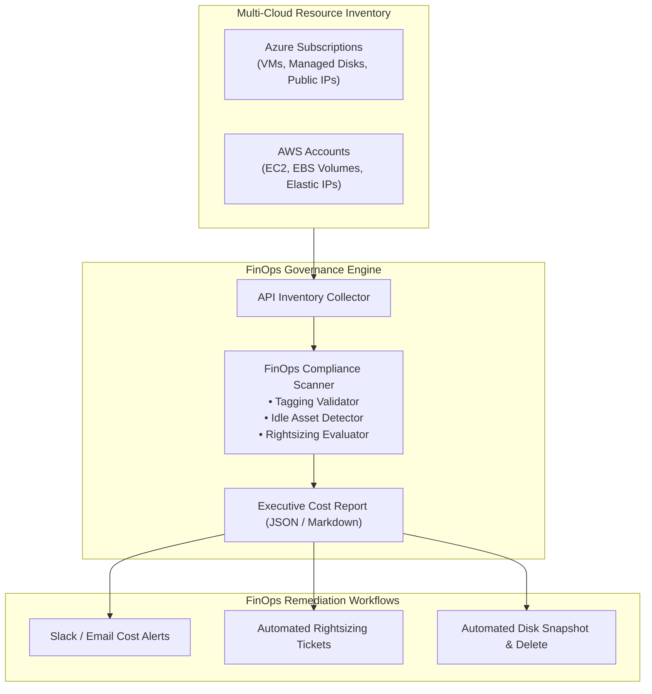

# Architecture Specification: FinOps Governance & Cost Waste Remediation

## 1. Governance Control Plane

The FinOps Governance toolchain provides scheduled audits against multi-cloud resource inventories to identify tagging violations, orphaned cloud assets, and compute over-provisioning.

## 2. Waste Reduction Targets

- **Target Tagging Compliance:** $> 95\%$ of all active resources tagged with valid CostCenter.
- **Orphaned Disks:** Zero unattached disks retained for $> 14$ days without exception approval.
- **Annual Savings Potential:** Typically saves 15% to 30% of total cloud infrastructure expenditure.

