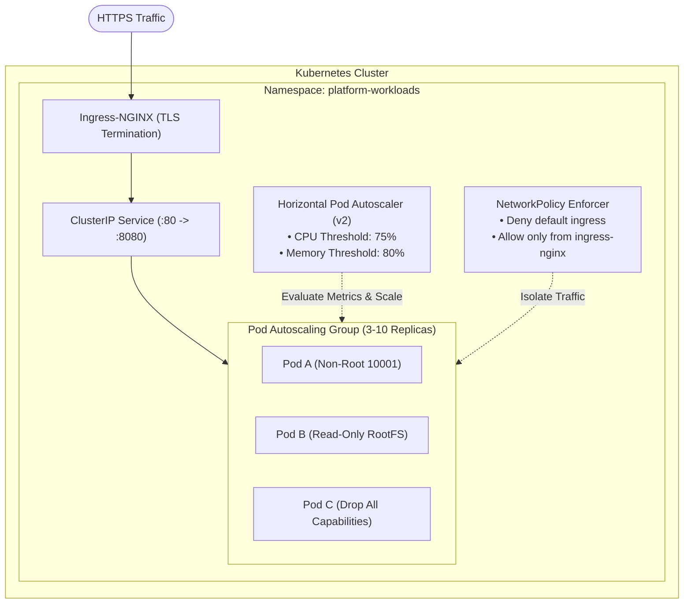

# Cloud-Native Kubernetes Platform & Helm Engineering

[](https://github.com/vikasrao-ops/kubernetes-platform/actions)
[](LICENSE)
[](https://kubernetes.io/)
[](https://helm.sh/)

A production-grade Kubernetes platform architecture featuring parameterized Helm 3 charts, Ingress-NGINX routing, Horizontal Pod Autoscaling (HPA), zero-trust NetworkPolicies, and restricted Pod Security Standards.

---

## 1. Problem Statement

Deploying microservices to Kubernetes without standardized templates often results in missing resource limits (causing node eviction), lack of automated horizontal scaling under high traffic, insecure container privileges, and unsegmented cluster networking where compromised pods can traverse laterally.

This repository provides an enterprise blueprint containing hardened Helm charts and declarative manifests that enforce zero-trust network boundaries, automated pod autoscaling, and zero-downtime rolling updates.

---

## 2. Architecture



---

## 3. Prerequisites

* **Kubernetes Cluster**: Version `>= 1.28` (Minikube, Kind, AKS, or EKS)
* **Kubectl CLI**: Version `>= 1.28`
* **Helm CLI**: Version `>= 3.12`
* **Metrics Server**: Required for HPA autoscaling evaluation

---

## 4. Technology Stack

* **Orchestrator:** Kubernetes
* **Package Manager:** Helm 3
* **Ingress Controller:** Ingress-NGINX
* **Security & Isolation:** Kubernetes NetworkPolicy, Pod Security Standards (Restricted)
* **Autoscaling:** Horizontal Pod Autoscaler (HPA v2)
* **Validation:** Kubeconform, Helm Lint

---

## 5. Installation & Local Setup

1. **Clone the repository:**
   ```bash
   git clone https://github.com/vikasrao-ops/kubernetes-platform.git
   cd kubernetes-platform
   ```

2. **Verify connection to Kubernetes cluster:**
   ```bash
   kubectl cluster-info
   ```

3. **Lint the Helm chart:**
   ```bash
   helm lint helm/
   ```

---

## 6. Implementation & Deployment Guide

### Option A: Deploy via Helm 3 (Recommended)
1. **Render template locally to verify syntax:**
   ```bash
   helm template test-app helm/ -f examples/values-production.yaml
   ```

2. **Install or upgrade release in `platform-workloads` namespace:**
   ```bash
   kubectl create namespace platform-workloads --dry-run=client -o yaml | kubectl apply -f -
   helm upgrade --install secure-workload helm/ \
     --namespace platform-workloads \
     --values examples/values-production.yaml
   ```

### Option B: Deploy via Declarative Manifests
```bash
kubectl apply -f manifests/deployment.yaml
```

---

## 7. Expected Output

Verify deployment, pods, and autoscaling:

```bash
kubectl get pods,svc,hpa,netpol -n platform-workloads
```

Output:
```text
NAME                                  READY   STATUS    RESTARTS   AGE
pod/secure-workload-7578b87f4-2v6kc   1/1     Running   0          42s
pod/secure-workload-7578b87f4-8p9lw   1/1     Running   0          42s
pod/secure-workload-7578b87f4-m9xql   1/1     Running   0          42s

NAME                          TYPE        CLUSTER-IP     EXTERNAL-IP   PORT(S)   AGE
service/secure-workload-svc   ClusterIP   10.96.14.210   <none>        80/TCP    42s

NAME                                                    REFERENCE                    TARGETS         MINPODS   MAXPODS   REPLICAS   AGE
horizontalpodautoscaler.autoscaling/secure-workload-hpa Deployment/secure-workload   cpu: 4%/75%     3         10        3          42s

NAME                                                    POD-SELECTOR          AGE
networkpolicy.networking.k8s.io/secure-workload-netpol  app=secure-workload   42s
```

---

## 8. Security Considerations

* **Restricted Security Context:** Root execution is forbidden (`runAsNonRoot: true`), capabilities are dropped (`drop: ["ALL"]`), and container root filesystems are mounted read-only.
* **Network Micro-segmentation:** Default-deny ingress NetworkPolicy prevents rogue pods in adjacent namespaces from scanning or connecting to application endpoints.
* **Service Account Token Mount Disabled:** Token automounting is disabled by default to eliminate lateral privilege escalation vectors via stolen service tokens.

---

## 9. Cost Considerations

* **Dynamic Elasticity:** Scales down to baseline minReplicas (3 pods) during low-traffic windows, minimizing wasted node capacity.
* **Predictable Limits:** Hard resource limits (`500m CPU`, `512Mi Memory`) prevent memory leaks from starving other workloads on shared cluster nodes.

---

## 10. Cleanup & Teardown

To remove all deployed workloads:

```bash
helm uninstall secure-workload -n platform-workloads
kubectl delete namespace platform-workloads
```

---

## 11. Known Limitations

* Horizontal Pod Autoscaling requires `metrics-server` installed in the cluster (`kubectl top pods` must function).
* NetworkPolicy enforcement depends on a CNI plugin that supports network policies (e.g., Calico, Cilium, Azure CNI with Cilium).

---

## 12. Future Improvements

* [ ] Implement ArgoCD Application CRDs for automated GitOps pull-based deployments.
* [ ] Add Kyverno cluster admission policies to validate non-root security contexts before pod creation.
* [ ] Integrate Prometheus ServiceMonitor CRDs for automated Prometheus Operator target discovery.

---

<div align="center">
  <sub>Maintained by <a href="https://github.com/vikasrao-ops">Vikas Rao</a> • Part of the Multi-Cloud DevOps Portfolio</sub>
</div>

