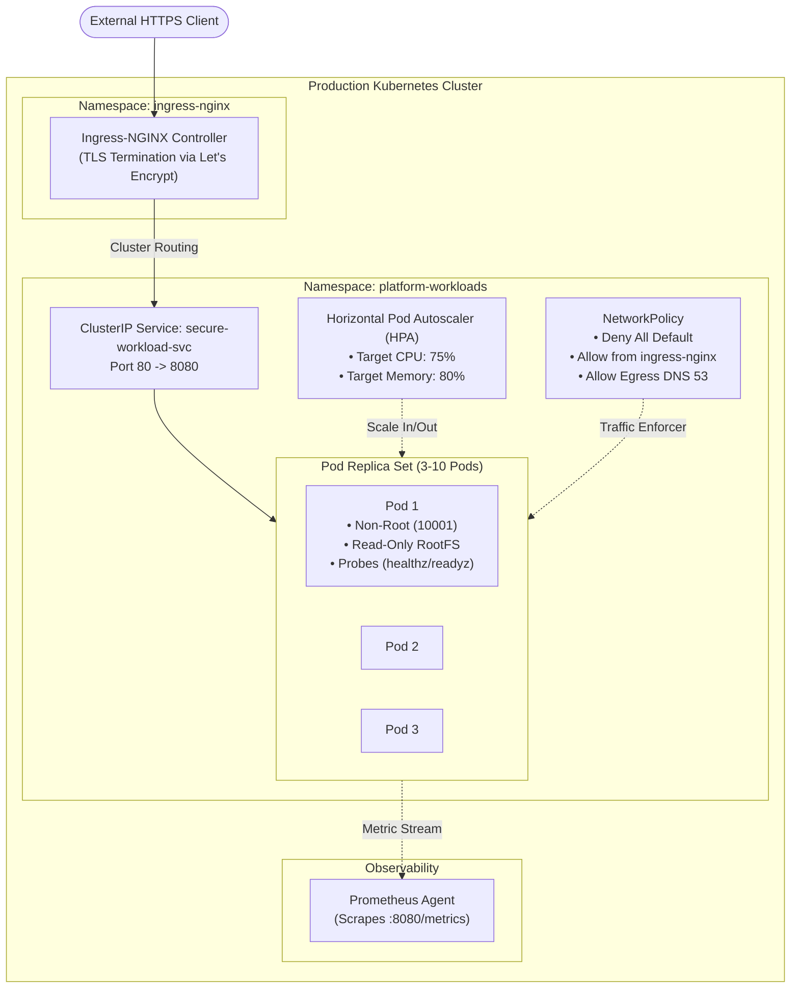

# Architecture Specification: Cloud-Native Kubernetes Platform

## 1. Architectural Topology

The Kubernetes platform architecture standardizes container orchestration for enterprise microservices, incorporating Ingress-NGINX routing, Horizontal Pod Autoscaling (HPA), zero-trust NetworkPolicies, and strict security contexts.

## 2. Pod Security Standards (PSS) Compliance

- **Restricted Profile:** Containers drop all Linux capabilities (`drop: ["ALL"]`), operate with read-only root filesystems, and mount ephemeral `/tmp` storage via `emptyDir`.
- **Zero-Downtime Releases:** RollingUpdate strategy with `maxSurge: 25%` and `maxUnavailable: 0` guarantees capacity during deployments.
- **Micro-segmentation:** NetworkPolicy rejects east-west lateral reconnaissance from untrusted namespaces.

