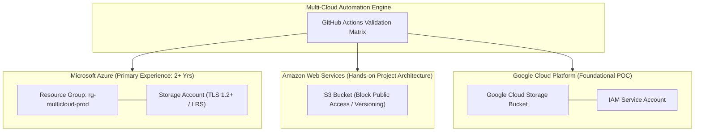

# Multi-Cloud Infrastructure Automation (Azure • AWS • GCP)

[](https://github.com/vikasrao-ops/multi-cloud-automation/actions)
[](LICENSE)
[](https://azure.microsoft.com/)
[](https://aws.amazon.com/)
[](https://cloud.google.com/)

A modular, cross-cloud automation framework demonstrating comparative infrastructure provisioning across **Microsoft Azure** (Primary Professional Stack), **Amazon Web Services** (Hands-on Architecture), and **Google Cloud Platform** (Foundational Storage & IAM POC).

---

## 1. Problem Statement

Organizations adopting multi-cloud strategies often suffer from fragmented tooling, incompatible resource naming, inconsistent tagging taxonomies, and cross-cloud blast radiuses.

This repository demonstrates how to architect a modular, decoupled Terraform framework that provisions and governs storage and IAM primitives across Azure, AWS, and GCP while adhering to provider-native security best practices.

---

## 2. Architecture



---

## 3. Prerequisites

* **Terraform CLI**: Version `>= 1.5.0`
* **Cloud CLIs**:
  * Azure CLI (`az`)
  * AWS CLI (`aws`)
  * Google Cloud SDK (`gcloud`)
* **Make** (optional)

---

## 4. Technology Stack

* **IaC Tool:** HashiCorp Terraform
* **Providers:** `hashicorp/azurerm`, `hashicorp/aws`, `hashicorp/google`
* **Automation & CI:** GitHub Actions Matrix Strategy
* **Cloud Platforms:** Microsoft Azure, Amazon Web Services, Google Cloud Platform

---

## 5. Comparative Cloud Matrix

For an in-depth architectural breakdown of networking, IAM, and storage paradigms across all three cloud providers, see [`docs/cloud-comparison-matrix.md`](docs/cloud-comparison-matrix.md).

---

## 6. Implementation & Deployment Guide

Each cloud environment is decoupled to prevent cross-cloud blast radius:

### Microsoft Azure
```bash
cd infrastructure/azure
terraform init
terraform plan
terraform apply -auto-approve
```

### Amazon Web Services (AWS)
```bash
cd infrastructure/aws
terraform init
terraform plan
terraform apply -auto-approve
```

### Google Cloud Platform (GCP)
```bash
cd infrastructure/gcp
terraform init
terraform plan
terraform apply -auto-approve
```

---

## 7. Expected Output

Each cloud module outputs its provisioned storage resource:

```text
# Azure Output
azure_resource_group = "rg-multicloud-prod"
azure_storage_account_name = "stmcorprod8291a"

# AWS Output
aws_s3_bucket_name = "s3-multicloud-prod-3829ab"

# GCP Output
gcs_bucket_name = "gcs-multicloud-poc-9182cd"
service_account_email = "sa-multicloud-poc@vikasrao-cloud-poc.iam.gserviceaccount.com"
```

---

## 8. Security Considerations

* **Decoupled Identity:** Prevents high-privilege super-tokens spanning all three clouds.
* **Public Access Prevention:** Enforced uniformly via `public_network_access_enabled = false` (Azure), `BlockPublicAcls` (AWS), and `uniform_bucket_level_access = true` (GCP).
* **Least-Privilege Roles:** Dedicated service identities bound only to specific required resources.

---

## 9. Cost Considerations

* All resources provisioned in this repository leverage standard tier storage with zero active compute charges when idle.

---

## 10. Cleanup & Teardown

Deprovision each cloud individually:

```bash
cd infrastructure/azure && terraform destroy -auto-approve
cd infrastructure/aws && terraform destroy -auto-approve
cd infrastructure/gcp && terraform destroy -auto-approve
```

---

## 11. Known Limitations

* Manages storage and IAM baseline; cross-cloud VPN tunnels or direct interconnects are not covered in this foundational module.

---

## 12. Future Improvements

* [ ] Add cross-cloud wireguard / IPsec VPN connectivity module.
* [ ] Integrate Infracost for unified cross-cloud cost breakdown reporting.
* [ ] Implement OpenTofu multi-backend testing pipeline.

---

<div align="center">
  <sub>Maintained by <a href="https://github.com/vikasrao-ops">Vikas Rao</a> • Part of the Multi-Cloud DevOps Portfolio</sub>
</div>

