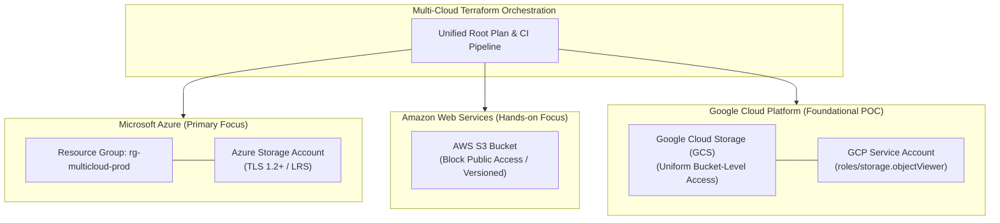

# Architecture Specification: Multi-Cloud Infrastructure Automation

## 1. Multi-Cloud Control Plane

This architecture establishes a provider-independent orchestration framework utilizing HashiCorp Terraform modules to manage resources across Microsoft Azure, AWS, and GCP foundational storage from a single automation repository.

## 2. Abstraction Design Guidelines

1. **Decoupled State:** Each cloud provider maintains an isolated remote backend state file to eliminate cross-cloud blast radius.
2. **Normalized Tagging:** Standardized tags (`Platform`, `Environment`, `ManagedBy`) ensure consistent FinOps auditing across all three cloud providers.
3. **Provider-Native Security:** Avoids generic lowest-common-denominator abstractions; applies provider-native zero-trust security controls for each cloud.

