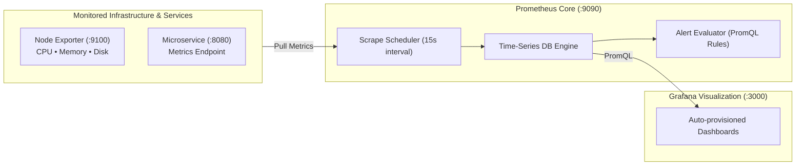

# Enterprise Cloud Observability Platform

[](https://github.com/vikasrao-ops/observability-platform/actions)
[](LICENSE)
[](https://prometheus.io/)
[](https://grafana.com/)

A turnkey, production-grade telemetry and observability stack built on Prometheus, Grafana, and Node Exporter. Includes automated datasource/dashboard provisioning as code, SLI/SLO tracking, threshold alerting, and incident response runbooks.

---

## 1. Problem Statement

Distributed cloud applications fail silently without centralized metric collection, leading to prolonged Mean Time to Detect (MTTD) and Mean Time to Resolution (MTTR). Ad-hoc dashboards and unversioned alert configurations degrade engineering reliability.

This repository provides an immutable, version-controlled observability stack deployable locally or to cloud virtual machines in seconds.

---

## 2. Architecture



---

## 3. Prerequisites

* **Docker Engine**: Version `>= 24.0`
* **Docker Compose**: Version `>= 2.20`
* **cURL** or web browser for interface verification

---

## 4. Technology Stack

* **Metrics Collection & TSDB:** Prometheus v2.51.0
* **Host Telemetry Agent:** Prometheus Node Exporter v1.7.0
* **Visualization Engine:** Grafana v10.4.0
* **Container Orchestration:** Docker Compose v3.8
* **Alerting Engine:** Prometheus PromQL Rules

---

## 5. Installation & Local Setup

1. **Clone the repository:**
   ```bash
   git clone https://github.com/vikasrao-ops/observability-platform.git
   cd observability-platform
   ```

2. **Launch the complete stack:**
   ```bash
   docker compose up -d
   ```

3. **Verify running containers:**
   ```bash
   docker compose ps
   ```

---

## 6. Implementation & Access Guide

Once launched, access the interfaces locally:

* **Grafana Dashboard:** [`http://localhost:3000`](http://localhost:3000)
  * Default Credentials: `admin` / `admin`
  * Dashboards auto-load under the **"Production Overview"** folder.
* **Prometheus UI & Targets:** [`http://localhost:9090`](http://localhost:9090)
  * View scrape targets: [`http://localhost:9090/targets`](http://localhost:9090/targets)
  * View active alerts: [`http://localhost:9090/alerts`](http://localhost:9090/alerts)
* **Node Exporter Raw Metrics:** [`http://localhost:9100/metrics`](http://localhost:9100/metrics)

---

## 7. Expected Output

Verify Prometheus query output for host CPU:

```promql
100 - (avg by (instance) (rate(node_cpu_seconds_total{mode="idle"}[5m])) * 100)
```

Output in Prometheus / Grafana shows real-time percentage utilization across all logical CPU cores.

---

## 8. Security Considerations

* **Read-Only Volume Mounts:** Configuration files are mounted `:ro` inside containers, preventing tampering.
* **Non-Root Runtime:** Prometheus and Grafana containers run under unprivileged internal UIDs.
* **Sign-Up Disabled:** `GF_USERS_ALLOW_SIGN_UP=false` prevents unauthorized user registration on Grafana.

---

## 9. Cost Considerations

* **100% Free Open Source:** Zero SaaS fees or per-host license overhead.
* **Storage Footprint:** Compact TSDB storage uses ~1-2 bytes per metric sample.

---

## 10. Cleanup & Teardown

To shut down containers and purge persistent test data:

```bash
docker compose down -v
```

---

## 11. Known Limitations

* Docker Compose deployment is designed for single-node / local laboratory environments. For clustered Kubernetes deployments, deploy via Prometheus Operator (kube-prometheus-stack).

---

## 12. Future Improvements

* [ ] Add Alertmanager integration with Slack / PagerDuty webhook dispatching.
* [ ] Integrate OpenTelemetry (OTel) Collector for unified tracing and log ingestion.
* [ ] Provision Grafana Loki for centralized log aggregation.

---

<div align="center">
  <sub>Maintained by <a href="https://github.com/vikasrao-ops">Vikas Rao</a> • Part of the Multi-Cloud DevOps Portfolio</sub>
</div>

