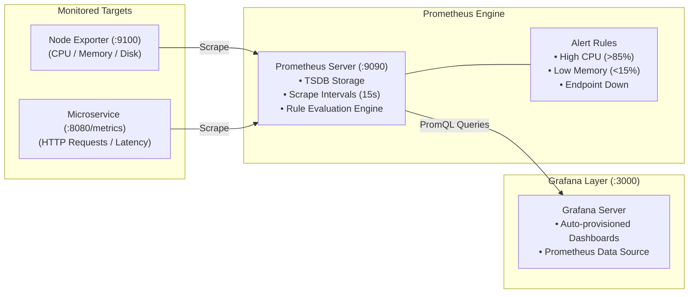

# Architecture Specification: Telemetry & Observability Platform

## 1. Metric Pipeline Topology

The Observability Platform establishes automated metric scraping, alerting thresholds, and visual dashboards across multi-cloud and containerized infrastructure using Prometheus and Grafana.

## 2. Retention and Storage Strategy

- **Storage Engine:** Prometheus TSDB with block compaction.
- **Retention:** Default 15 days on local volume for operational alerting; historical metrics can be forwarded to long-term object storage via Thanos or Cortex.

