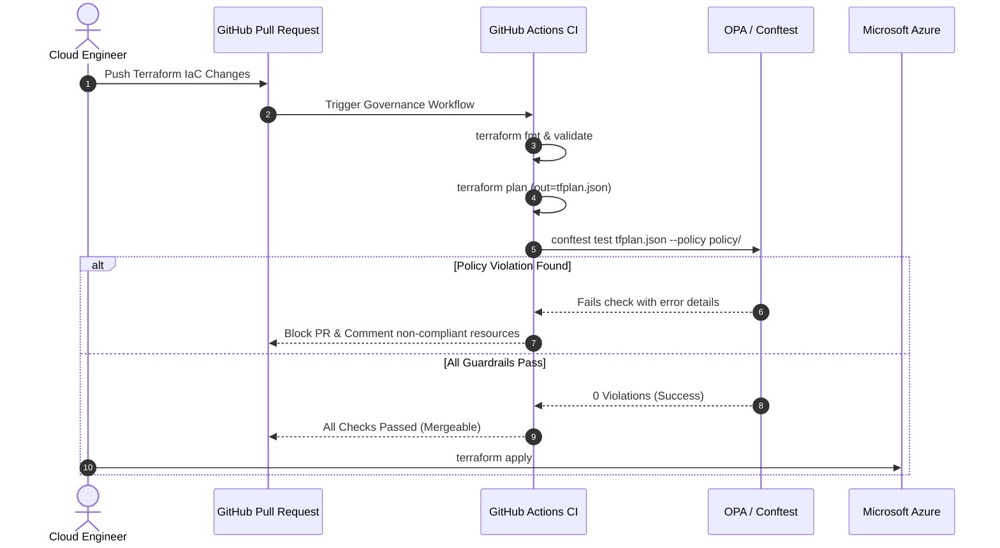

# Terraform Azure Governance & Policy-as-Code

[](https://www.terraform.io/)
[](https://github.com/features/actions)
[](https://www.openpolicyagent.org/)
[](https://www.conftest.dev/)

An automated cloud governance platform for Microsoft Azure. Uses Open Policy Agent (OPA / Rego) and Conftest integrated into GitHub Actions CI to enforce mandatory tag taxonomy, regional boundaries, encryption standards, and network isolation before Terraform changes can be provisioned.

---

## Governance Workflow



---

## Policy-as-Code Guardrail Matrix

| Policy Rule | Target Azure Resource | Rule Definition | Compliance Goal |
| :--- | :--- | :--- | :--- |
| **`tags.rego`** | All Resources | Must include: `Environment`, `Owner`, `Project`, `CostCenter`, `ManagedBy` | FinOps accountability & resource ownership |
| **`regions.rego`** | Resource Groups / VNets | Restricted to: `eastus`, `eastus2`, `centralus`, `westeurope` | Data residency compliance |
| **`network.rego`** | Network Security Groups | Disallows inbound `0.0.0.0/0` on port `22` (SSH) or `3389` (RDP) | Perimeter attack surface elimination |
| **`storage.rego`** | Storage Accounts | Requires `enable_https_traffic_only = true` and `min_tls_version = "TLS1_2"` | Zero-trust encryption in transit |

---

## Code Highlights

### 1. Open Policy Agent (Rego) Tag Policy (`policy/tags.rego`)
```rego
package azure.governance.tags
import future.keywords.in

required_tags := ["Environment", "Owner", "Project", "CostCenter", "ManagedBy"]

# Enforce required tags on all resource creations and updates
deny[msg] {
    some resource in input.resource_changes
    resource.change.actions[_] in ["create", "update"]
    
    some tag in required_tags
    not resource.change.after.tags[tag]
    msg := sprintf("Policy Violation: Resource '%v' is missing mandatory tag '%v'. Required tags: %v", [resource.address, tag, required_tags])
}
```

### 2. Compliant Terraform Storage & Network Configuration
```hcl
# Storage account compliant with in-transit encryption policy
resource "azurerm_storage_account" "secure_storage" {
  name                     = "stazgovprod7819"
  resource_group_name      = azurerm_resource_group.rg.name
  location                 = azurerm_resource_group.rg.location
  account_tier             = "Standard"
  account_replication_type = "GRS"

  enable_https_traffic_only = true
  min_tls_version           = "TLS1_2"

  tags = var.tags
}
```

### 3. GitHub Actions Governance Workflow (`.github/workflows/governance.yml`)
```yaml
jobs:
  policy-evaluation:
    name: 'Lint & OPA Policy Evaluation'
    runs-on: ubuntu-latest
    steps:
      - uses: actions/checkout@v4
      - uses: hashicorp/setup-terraform@v3
        with:
          terraform_version: 1.5.7

      - name: Terraform Plan & JSON Conversion
        run: |
          terraform init -backend=false
          terraform plan -out=tfplan.bin
          terraform show -json tfplan.bin > tfplan.json
        working-directory: infrastructure

      - name: Evaluate OPA Rego Policies with Conftest
        run: conftest test infrastructure/tfplan.json --policy policy/ --output table
```

---

## Repository Structure

```
.
├── .github/
│   └── workflows/
│       └── governance.yml          # GitHub Actions OPA validation workflow
├── policy/                         # Rego guardrail definitions
│   ├── tags.rego                   # Tag schema validation
│   ├── regions.rego                # Allowed regions enforcement
│   ├── network.rego                # Ingress boundary checks
│   ├── storage.rego                # TLS and HTTPS encryption rules
│   └── tests/
│       └── governance_test.rego    # Automated test cases
├── infrastructure/
│   ├── main.tf                     # Compliant resource definitions
│   ├── variables.tf                # Parameter declarations
│   ├── outputs.tf                  # Exported outputs
│   └── versions.tf                 # Provider constraints
└── examples/
    └── terraform.tfvars.example    # Compliant sample variables
```

---

## Local Policy Verification

```bash
cd infrastructure
terraform init -backend=false
terraform plan -var-file="../examples/terraform.tfvars.example" -out=tfplan.bin
terraform show -json tfplan.bin > tfplan.json

conftest test tfplan.json --policy ../policy/
conftest verify --policy ../policy/
```
