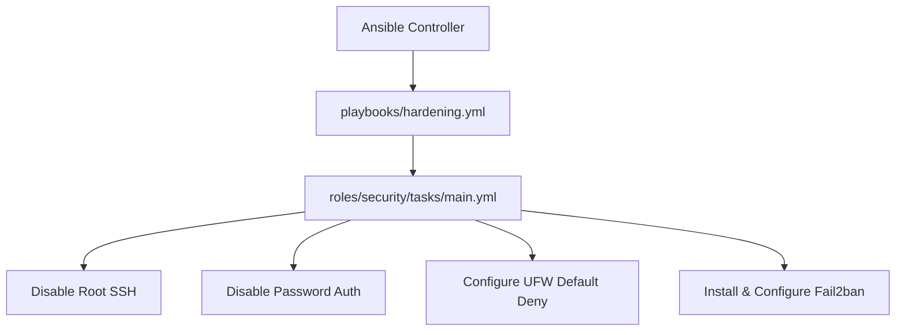

# Automated Linux OS Hardening & Security Baseline Lab (Ansible)

[](LICENSE)
[](https://ansible.com)
[](https://github.com/vikasrao-ops)

An idempotent, modular Ansible automation laboratory implementing Linux operating system security baselining: root SSH prohibition, public-key authentication enforcement, UFW host firewalling, and intrusion prevention via Fail2ban.

---

## 1. Problem Statement
Manual configuration of fleet Linux virtual machines results in configuration drift, inconsistent firewall rules, and neglected default passwords that leave systems vulnerable to brute-force attacks.

## 2. Architecture


## 3. Prerequisites
* Ansible `>= 2.15`
* Target Ubuntu / Debian Linux hosts with SSH connectivity

## 4. Technology Stack
* Ansible Core
* Python 3
* UFW (Uncomplicated Firewall)
* Fail2ban

## 5. Repository Structure
* `ansible.cfg`: Global Ansible configuration.
* `inventory.ini`: Host inventory partitioned by role (`webservers`, `dbservers`).
* `playbooks/hardening.yml`: Master baseline execution playbook.
* `roles/security/tasks/main.yml`: Modular security tasks.

## 6. Implementation & Execution
```bash
# Verify playbook syntax
ansible-playbook playbooks/hardening.yml --syntax-check

# Execute dry-run (check mode)
ansible-playbook playbooks/hardening.yml --check --diff

# Apply security hardening
ansible-playbook playbooks/hardening.yml
```

## 7. Expected Output
```text
PLAY [Apply Linux OS Security Baseline] ****************************************
TASK [security : Install baseline security packages] ***************************
changed: [web-node-01]
TASK [security : Disable SSH root login] ***************************************
changed: [web-node-01]
TASK [security : Disable password-based SSH authentication] ********************
changed: [web-node-01]
TASK [security : Set UFW default incoming policy to deny] **********************
ok: [web-node-01]
RUNNING HANDLER [Restart sshd] *************************************************
changed: [web-node-01]
PLAY RECAP *********************************************************************
web-node-01 : ok=5  changed=4  unreachable=0  failed=0
```

## 8. Security Considerations
* **Elimination of Password Brute-Force:** `PasswordAuthentication no` prevents dictionary attacks against host SSH ports.
* **Least-Privilege SSH:** `PermitRootLogin no` forces administrators to authenticate as unprivileged users before elevating via `sudo`.

## 9. Cost Considerations
* Agentless architecture: Communicates over native OpenSSH with zero background memory overhead or commercial licensing fees.

## 10. Cleanup & Teardown
To revert modifications, invoke a remediation playbook or reprovision virtual machines via Terraform.

## 11. Known Limitations
* Tailored for Debian/Ubuntu distributions (`apt`/`ufw`); RedHat/CentOS implementations require `dnf`/`firewalld` adaptations.

## 12. Future Improvements
* [ ] Add RedHat/Rocky Linux task compatibility via `ansible_os_family` conditionals.
* [ ] Integrate automated OpenSCAP compliance scanning report generation.

