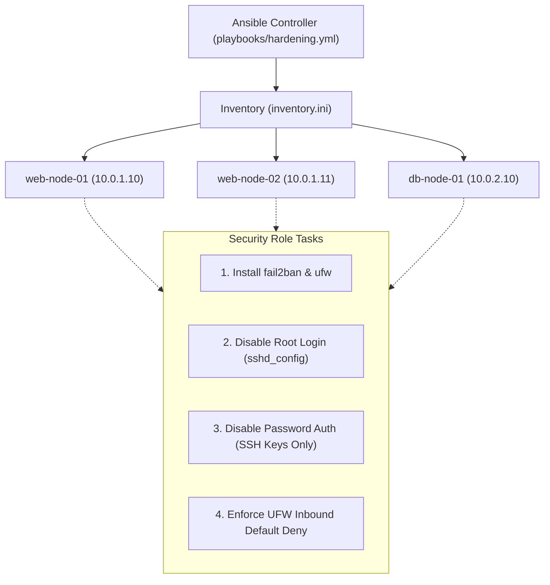

# Architecture Specification: Automated Linux OS Hardening

## Architectural Strategy
Demonstrates declarative, idempotent operating system configuration management. Establishes a zero-trust host baseline across fleet virtual machines.

