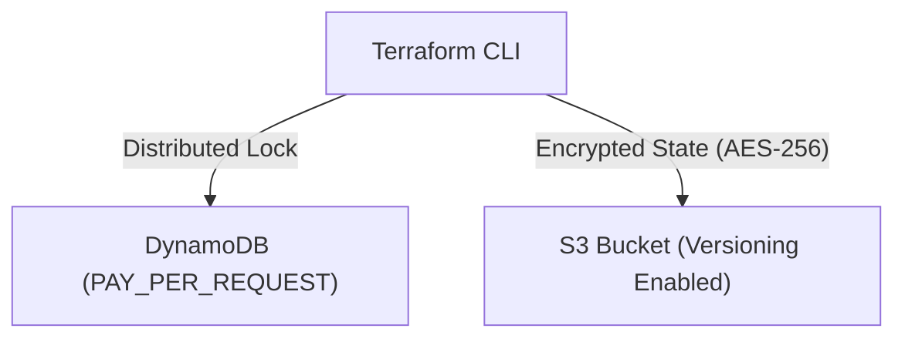

# AWS Terraform Remote State & DynamoDB Locking POC

[](LICENSE)
[](https://aws.amazon.com/)
[](https://terraform.io)

A hands-on engineering lab implementing production-standard AWS remote state storage and distributed state locking using Amazon S3 and DynamoDB.

> **Engineering Note:** An independent hands-on cloud project demonstrating AWS infrastructure patterns.

---

## 1. Problem Statement
Storing Terraform state locally in team environments causes race conditions, state file corruption, and accidental exposure of sensitive infrastructure attributes. This POC creates a secure, encrypted remote state backend with atomic locking.

## 2. Architecture


## 3. Prerequisites
* Terraform CLI `>= 1.5.0`
* AWS CLI `>= 2.15.0` configured with valid credentials

## 4. Technology Stack
* HashiCorp Terraform
* AWS Provider v5.40+ (S3, DynamoDB)

## 5. Installation & Setup
```bash
git clone https://github.com/vikasrao-ops/aws-terraform-poc.git
cd aws-terraform-poc/infrastructure
terraform init
```

## 6. Implementation & Execution
```bash
terraform fmt
terraform plan -out=tfplan
terraform apply tfplan
```

## 7. Expected Output
```text
Apply complete! Resources: 5 added, 0 changed, 0 destroyed.
Outputs:
dynamodb_table_name = "terraform-locks-poc"
terraform_state_bucket_name = "tfstate-backend-poc-8f9a2b"
```

## 8. Security Considerations
* S3 bucket blocks 100% of public access (`BlockPublicAcls`, `BlockPublicPolicy`).
* Server-side encryption is mandatory (`AES256`).
* Object versioning safeguards against accidental destruction or state rollback errors.

## 9. Cost Considerations
* Zero baseline cost: DynamoDB operates on `PAY_PER_REQUEST` billing; S3 charges negligible pennies for small state payloads.

## 10. Cleanup & Teardown
```bash
terraform destroy -auto-approve
```

## 11. Known Limitations
* S3 bucket force destruction is disabled by default to prevent catastrophic state loss; bucket must be empty before destroying.

## 12. Future Improvements
* [ ] Add cross-region S3 replication for disaster recovery.
* [ ] Integrate AWS KMS Customer Managed Keys (CMK).

