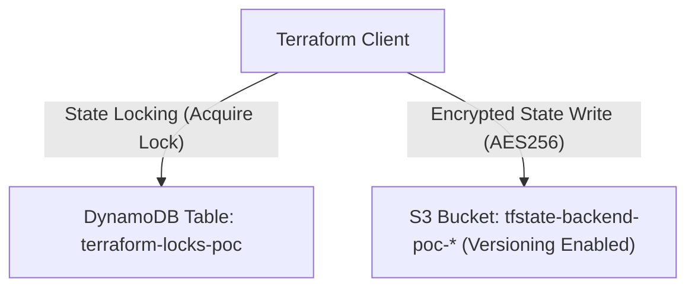

# Architecture Specification: AWS Terraform Remote State POC

## Architectural Topology
Demonstrates best-practice AWS remote state infrastructure with S3 object versioning and DynamoDB concurrency locking (`LockID`).

