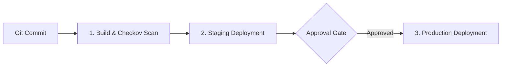

# Multi-Stage Azure DevOps Pipeline & Gated Approvals

[](LICENSE)
[](https://azure.microsoft.com/services/devops/)
[](https://github.com/vikasrao-ops)

A production-proven, multi-stage Azure DevOps YAML pipeline featuring automated unit testing, Checkov IaC security scanning, staging environment deployments, and manual approval gates for production releases.

---

## 1. Problem Statement
Manual release deployments and non-standardized CI/CD scripts introduce human error, lack audit trails, and risk deploying unverified changes directly to production environments.

## 2. Architecture


## 3. Prerequisites
* Azure DevOps Organization & Project
* Azure Subscription with configured Service Connection (`Azure Resource Manager`)
* Ubuntu-latest hosted or self-hosted agent pool

## 4. Technology Stack
* Azure DevOps YAML Pipelines
* Checkov IaC Security Scanner
* Python 3.12 / Bash automation scripts

## 5. Pipeline Structure
* [`azure-pipelines.yml`](azure-pipelines.yml): Multi-stage declarative pipeline.
* [`scripts/build.sh`](scripts/build.sh): Automated test runner.
* [`scripts/deploy.sh`](scripts/deploy.sh): Environment deployment handler.

## 6. Implementation & Execution
1. Import repository into Azure DevOps.
2. Link Azure Resource Manager Service Connection as `sc-azure-platform-prod`.
3. Configure **Environment Checks** on the `production` environment to require designated approver sign-off.
4. Run pipeline against `main` branch.

## 7. Expected Output
Azure DevOps pipeline execution dashboard displays 3 green stages:
```text
Stage 1: Build & Security Scan (Passed)
Stage 2: Deploy to Staging (Passed)
Stage 3: Deploy to Production (Gated Approval Verified -> Deployed)
```

## 8. Security Considerations
* Uses Azure Service Connection with federated Workload Identity (no long-lived service principal client secrets stored in pipeline variables).
* Checkov blocks merges if severe misconfigurations are discovered in Terraform files.

## 9. Cost Considerations
* Included in standard Azure DevOps free tier (1 parallel Microsoft-hosted job with 1,800 free minutes/month).

## 10. Cleanup & Teardown
To remove deployed environments, invoke deprovisioning targets via Azure CLI or pipeline destroy job.

## 11. Known Limitations
* Requires elevated administrative permissions in Azure DevOps to configure environment approval gates.

## 12. Future Improvements
* [ ] Integrate SonarQube quality gate task.
* [ ] Add automated blue-green slot swapping for Azure App Service workloads.

