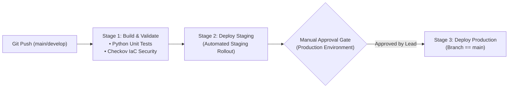

# Architecture Specification: Multi-Stage Azure DevOps Pipeline

## Architectural Pipeline Topology
Demonstrates enterprise-grade multi-stage Azure DevOps YAML pipeline execution incorporating automated security scanning and gated production approvals.

