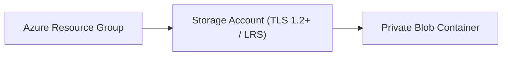

# Azure Storage & Compute Automation POC (Terraform)

[](LICENSE)
[](https://azure.microsoft.com/)
[](https://terraform.io)

A hands-on proof-of-concept demonstrating automated, idempotent provisioning of Microsoft Azure core storage services and private container namespaces using modern Terraform patterns.

---

## 1. Problem Statement
Manual creation of cloud storage resources via the Azure Portal causes configuration drift, non-standard naming conventions, and inconsistent security settings. This POC automates storage account and container provisioning via declarative Terraform.

## 2. Architecture


## 3. Prerequisites
* Terraform CLI `>= 1.5.0`
* Azure CLI `>= 2.50.0` authenticated via `az login`

## 4. Technology Stack
* HashiCorp Terraform
* AzureRM Provider v3.90+

## 5. Installation & Setup
```bash
git clone https://github.com/vikasrao-ops/azure-terraform-poc.git
cd azure-terraform-poc/infrastructure
terraform init
```

## 6. Implementation & Execution
```bash
terraform fmt
terraform plan -out=tfplan
terraform apply tfplan
```

## 7. Expected Output
```text
Apply complete! Resources: 3 added, 0 changed, 0 destroyed.
Outputs:
storage_account_name = "stpocpoc7a8b9c"
container_name = "artifacts"
```

## 8. Security Considerations
* Enforces `min_tls_version = "TLS1_2"`.
* Blob container access type is strictly `private` (no anonymous public read).

## 9. Cost Considerations
* Minimal cost: Standard LRS storage is billed on storage volume consumed (< \$0.02/GB/month).

## 10. Cleanup & Teardown
```bash
terraform destroy -auto-approve
```

## 11. Known Limitations
* Designed as a standalone storage lab; network private endpoints are implemented in the `azure-enterprise-landing-zone` flagship.

## 12. Future Improvements
* [ ] Add customer-managed Key Vault encryption key.
* [ ] Add automated lifecycle management rule.

