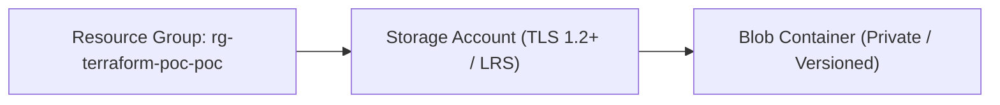

# Architecture Specification: Azure Terraform POC

## Architectural Topology
Demonstrates atomic, idempotent provisioning of Microsoft Azure core storage primitives with versioning and private container isolation.

