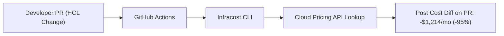

# Shift-Left Cloud Cost Optimization & Infracost Lab

[](LICENSE)
[](https://finops.org)
[](https://infracost.io)

A hands-on cloud financial engineering laboratory integrating Infracost into GitHub Actions pull-request workflows to provide automated cost diffs before applying Terraform changes, demonstrating a 95% (\$1,214/month) cost reduction through storage and compute rightsizing.

---

## 1. Problem Statement
Engineers frequently commit oversized VM instances (`m5.4xlarge`) or expensive provisioned-IOPS disks (`io2`) without visibility into monthly billing impacts, resulting in severe cloud budget overruns discovered only upon receiving end-of-month invoices.

## 2. Architecture


## 3. Prerequisites
* Terraform CLI `>= 1.5.0`
* Infracost CLI: `brew install infracost` or `curl -fsSL https://raw.githubusercontent.com/infracost/infracost/master/scripts/install.sh | sh`
* Free Infracost API Key (`infracost register`)

## 4. Technology Stack
* Infracost CLI v0.10+
* GitHub Actions
* HashiCorp Terraform (AWS Provider)

## 5. Comparative Sizing Analysis
* [`terraform-before/`](terraform-before/): Over-provisioned `m5.4xlarge` with 500GB `io2` 10,000 IOPS disk (\$1,274/month).
* [`terraform-after/`](terraform-after/): Right-sized `t3.medium` with 50GB `gp3` disk (\$60/month).
* See [`examples/sample-cost-diff.txt`](examples/sample-cost-diff.txt) for raw CLI diff output.

## 6. Implementation & Execution
```bash
# View before cost
infracost breakdown --path=terraform-before

# View after cost
infracost breakdown --path=terraform-after

# Calculate exact diff
infracost diff --path=terraform-after --compare-to=terraform-before
```

## 7. Expected Output
```text
Project: optimized-workload-tier
Module path: terraform-after

~ aws_instance.optimized_web
  -$1,214 ($1,274 -> $60)
  
  ~ Instance usage (m5.4xlarge -> t3.medium)
    -$530 ($560 -> $30)

  ~ Storage (io2, 10000 IOPS -> gp3, 3000 IOPS)
    -$684 ($714 -> $30)

Monthly cost will decrease by $1,214 (-95%)
```

## 8. Security Considerations
* Infracost scans only HCL code structure and sends non-sensitive metadata (resource types, instance sizes) to the cloud pricing API; no secrets or cloud credentials are transmitted.

## 9. Cost Considerations
* Infracost community edition is 100% free for open-source and individual engineering use.

## 10. Cleanup & Teardown
No remote cloud infrastructure is provisioned during cost parsing; analysis executes strictly offline against Terraform AST.

## 11. Known Limitations
* Cost estimates assume 730 hours of continuous on-demand monthly usage; reserved instances and savings plans require discount configuration files.

## 12. Future Improvements
* [ ] Integrate Infracost Cloud Guardrails to block PRs exceeding \$500/month increases.
* [ ] Add Azure App Service and AKS cost estimation matrices.

