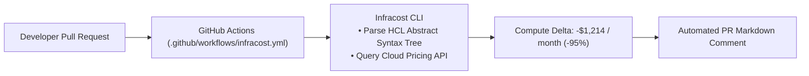

# Architecture Specification: Infracost Shift-Left Cloud Financial Engineering

## Architectural Workflow
Demonstrates automated pull-request cost estimation using Infracost to project monthly dollar impacts before merging Terraform changes.

