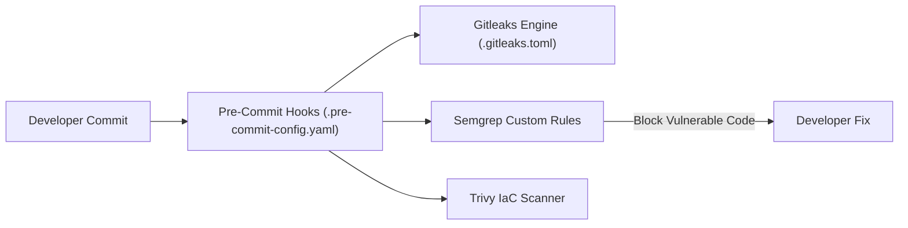

# DevSecOps Security Toolchain & Pre-Commit Engineering Lab

[](LICENSE)
[](https://pre-commit.com/)
[](https://semgrep.dev/)
[](https://github.com/gitleaks/gitleaks)

A hands-on DevSecOps security engineering laboratory implementing localized shift-left defenses: custom Semgrep SAST rule authoring, enterprise Gitleaks token patterns, and pre-commit hook automation.

---

## 1. Problem Statement
Remediating security vulnerabilities in production is 10x to 100x more expensive than catching them during development. Ad-hoc reviews fail to catch leaked developer secrets and dangerous framework debug flags.

## 2. Architecture


## 3. Prerequisites
* Python `>= 3.10`
* `pre-commit` CLI: `pip install pre-commit`
* Optional: `semgrep`, `gitleaks`, `trivy` installed locally

## 4. Technology Stack
* Pre-Commit Framework v4.6+
* Semgrep v1.70+
* Gitleaks v8.18+
* Aqua Trivy

## 5. Security Tooling Configuration
* `.pre-commit-config.yaml`: Git hook orchestration pipeline.
* `.gitleaks.toml`: Enterprise secret scanning rules with custom regex.
* `rules/custom-semgrep-rules.yml`: Custom security rules targeting insecure debug flags and hardcoded tokens.

## 6. Implementation & Execution
```bash
# Install git hooks into local .git directory
pre-commit install

# Execute manual scan across all files
pre-commit run --all-files

# Scan vulnerable example to view rule triggers
semgrep --config rules/custom-semgrep-rules.yml examples/vulnerable-app.py
```

## 7. Expected Output
Semgrep blocks vulnerable code:
```text
examples/vulnerable-app.py
   14┆ app.run(host="0.0.0.0", port=5000, debug=True)
       Flask app detected running with debug=True in code. This permits arbitrary remote code execution.
```
Remediated code passes cleanly:
```text
semgrep --config rules/custom-semgrep-rules.yml examples/remediated-app.py
Ran 2 rules on 1 file: 0 findings.
```

## 8. Security Considerations
* **Local Quarantine:** Hooks prevent secrets from being recorded into Git commit history, avoiding expensive repository history purging.
* **Granular Whitelisting:** Pattern exclusions are restricted to designated test fixtures.

## 9. Cost Considerations
* 100% open-source toolchain with zero recurring SaaS licensing costs.

## 10. Cleanup & Teardown
```bash
pre-commit uninstall
```

## 11. Known Limitations
* Pre-commit hooks can be bypassed locally with `git commit --no-verify`; must always be paired with server-side GitHub Actions verification.

## 12. Future Improvements
* [ ] Add OPA Rego policies for Terraform plan checks.
* [ ] Integrate automated commit signing verification (`git log --show-signature`).

