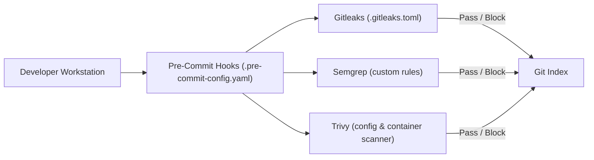

# Architecture Specification: DevSecOps Security Toolchain

## Architectural Workflow
Demonstrates localized developer shift-left defenses. Prevents code with secrets or common misconfigurations from ever leaving the local developer terminal.

