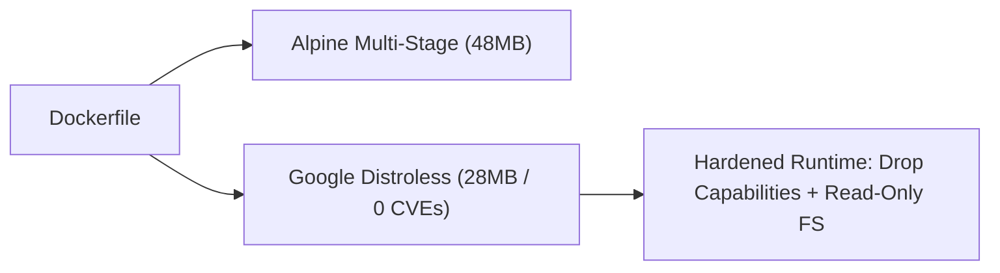

# Docker Container Hardening & Distroless Benchmarking Lab

[](LICENSE)
[](https://docker.com)
[](https://github.com/GoogleContainerTools/distroless)

A hands-on container security engineering laboratory demonstrating multi-stage optimization, comparison between Alpine Linux and Google Distroless base images, read-only root filesystems, and Linux capability drops.

---

## 1. Problem Statement
Monolithic Docker images carrying package managers, debug tools, and running as root expand the attack surface, inflate container registry transfer times, and introduce dozens of preventable CVE vulnerabilities.

## 2. Architecture


## 3. Prerequisites
* Docker Engine `>= 24.0`
* Docker Compose `>= 2.20`

## 4. Technology Stack
* Docker / Buildx
* Google Distroless (`gcr.io/distroless/python3-debian12`)
* Alpine Linux 3.12
* Python 3.12 / Flask

## 5. Benchmarking Metrics
See [`examples/container-benchmark.md`](examples/container-benchmark.md) for detailed image footprint and vulnerability comparisons.

## 6. Implementation & Execution
```bash
# Build Alpine hardened variant
docker build -f src/Dockerfile.alpine -t secure-app:alpine src/

# Build Google Distroless variant
docker build -f src/Dockerfile.distroless -t secure-app:distroless src/

# Run with read-only root filesystem and dropped capabilities
docker compose up -d
```

## 7. Expected Output
```text
[+] Running 1/1
 ✔ Container hardened-web  Started
```
Verify unprivileged runtime:
```bash
docker exec -it hardened-web id
# Output: uid=10001(appuser) gid=10001(appgroup)
```

## 8. Security Considerations
* **Zero Shell Binaries:** Distroless eliminates `/bin/sh` and `/bin/bash`, preventing shell injection attacks.
* **Kernel Isolation:** Drops all Linux capabilities (`cap_drop: ALL`) and enforces read-only filesystem mounting with memory-backed `/tmp`.

## 9. Cost Considerations
* Reducing image size from 1GB to 28MB slashes container registry data transfer costs by >95% during CI/CD builds.

## 10. Cleanup & Teardown
```bash
docker compose down
```

## 11. Known Limitations
* Distroless images cannot be debugged with `docker exec -it ... /bin/sh` because no shell binary exists; ephemeral debug containers must be attached.

## 12. Future Improvements
* [ ] Integrate Docker Scout automated CVE remediation suggestions.
* [ ] Add multi-architecture cross-compilation (`linux/amd64`, `linux/arm64`).

