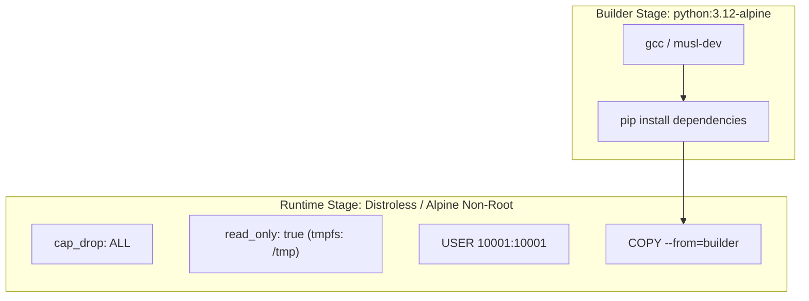

# Architecture Specification: Container Hardening & Distroless Benchmarking

## Architectural Strategy
Demonstrates multi-stage build pipelines comparing Alpine and Google Distroless runtime bases to eliminate compilers, package managers, and root permissions.

