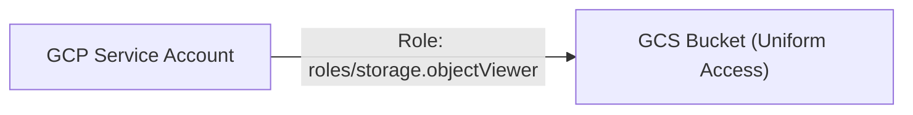

# Google Cloud Platform Foundation POC (Terraform)

[](LICENSE)
[](https://cloud.google.com/)
[](https://terraform.io)

A foundational proof-of-concept demonstrating Google Cloud Storage (GCS) security baselines and least-privilege IAM service account configuration with HashiCorp Terraform.

> **Engineering Note:** Foundational knowledge and technical POC exploration on Google Cloud Platform.

---

## 1. Problem Statement
Securing storage in GCP requires shifting away from legacy fine-grained ACLs toward Uniform Bucket-Level Access and ensuring applications access objects strictly through dedicated service accounts rather than ambient permissions.

## 2. Architecture


## 3. Prerequisites
* Terraform CLI `>= 1.5.0`
* Google Cloud SDK (`gcloud`) authenticated via `gcloud auth application-default login`

## 4. Technology Stack
* HashiCorp Terraform
* Google Provider v5.20+ (GCS, IAM)

## 5. Installation & Setup
```bash
git clone https://github.com/vikasrao-ops/gcp-foundation-poc.git
cd gcp-foundation-poc/infrastructure
terraform init
```

## 6. Implementation & Execution
```bash
terraform fmt
terraform plan -out=tfplan
terraform apply tfplan
```

## 7. Expected Output
```text
Apply complete! Resources: 4 added, 0 changed, 0 destroyed.
Outputs:
bucket_name = "gcs-foundation-poc-5c8e2a"
service_account_email = "sa-gcp-foundation-poc@vikasrao-cloud-lab.iam.gserviceaccount.com"
```

## 8. Security Considerations
* **Uniform Bucket-Level Access:** Prohibits individual object ACL bypasses; all permissions are governed centrally via Cloud IAM.
* **Role Principle:** Binds `roles/storage.objectViewer` exclusively to the application service account.
* **Automated Expiration:** Enforces a 30-day lifecycle purge on temporary diagnostic objects.

## 9. Cost Considerations
* Zero base cost when idle; standard storage is billed at \$0.020 per GB/month in `us-central1`.

## 10. Cleanup & Teardown
```bash
terraform destroy -auto-approve
```

## 11. Known Limitations
* Bucket name is globally unique across Google Cloud and must conform to DNS naming specifications.

## 12. Future Improvements
* [ ] Integrate Google Cloud KMS Customer Managed Encryption Keys (CMEK).
* [ ] Add Workload Identity Federation for keyless GitHub Actions deployment.

