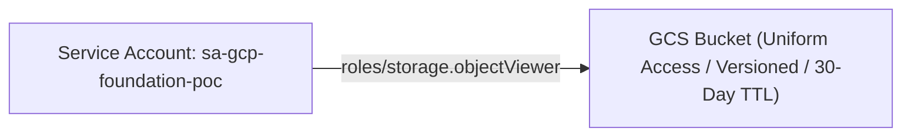

# Architecture Specification: GCP Foundation POC

## Architectural Topology
Demonstrates foundational Google Cloud Platform infrastructure incorporating Google Cloud Storage (GCS) uniform access policies and least-privilege IAM service account bindings.

