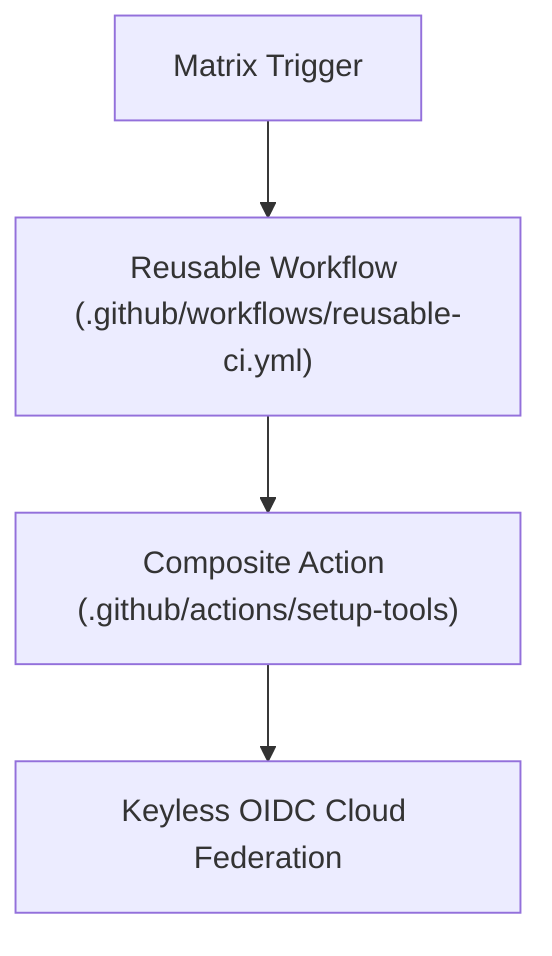

# Advanced GitHub Actions Automation Lab

[](LICENSE)
[](https://github.com/features/actions)
[](https://docs.github.com/en/actions/deployment/security-hardening-your-deployments/about-security-hardening-with-openid-connect)

A technical reference laboratory demonstrating advanced GitHub Actions patterns: matrix build execution across operating systems, reusable workflow invocation (`workflow_call`), custom composite actions, and keyless OIDC cloud authentication.

---

## 1. Problem Statement
Repetitive workflow definitions across repositories lead to configuration drift, security maintenance burdens, and credential compromise via static long-lived API tokens.

## 2. Architecture


## 3. Prerequisites
* GitHub account with GitHub Actions enabled
* Git CLI

## 4. Technology Stack
* GitHub Actions
* YAML Workflow Specification
* Bash Shell Automation

## 5. Repository Structure
* `.github/actions/setup-tools/action.yml`: Standardized composite tool setup.
* `.github/workflows/reusable-ci.yml`: Parameterized reusable CI workflow.
* `.github/workflows/main.yml`: Cross-platform matrix test pipeline.
* `examples/oidc-azure-aws-blueprint.md`: Step-by-step keyless cloud connection guide.

## 6. Implementation & Execution
Commit changes or trigger manually via GitHub Actions console to observe matrix execution across Ubuntu and Windows runners.

## 7. Expected Output
```text
✓ Matrix Build (ubuntu-latest, Python 3.11) - Passed
✓ Matrix Build (ubuntu-latest, Python 3.12) - Passed
✓ Matrix Build (windows-latest, Python 3.11) - Passed
✓ Matrix Build (windows-latest, Python 3.12) - Passed
✓ Trigger Reusable Pipeline (Staging) - Passed
```

## 8. Security Considerations
* **Keyless OIDC:** Eliminates long-lived access keys by leveraging short-lived cryptographic tokens issued directly to cloud providers.
* **Minimal Scope:** Enforces granular job permissions (`permissions: contents: read`).

## 9. Cost Considerations
* Optimized matrix execution finishes within seconds, minimizing GitHub Actions runner minutes.

## 10. Cleanup & Teardown
No persistent infrastructure provisioned; workflows run on ephemeral GitHub-hosted runners.

## 11. Known Limitations
* Windows runners incur 2x billing rate multiplier compared to Linux runners on private repositories (free for public repositories).

## 12. Future Improvements
* [ ] Integrate GitHub Actions environment deployment protection rules.
* [ ] Add dynamic concurrency cancellation for stale pull-request pushes.

