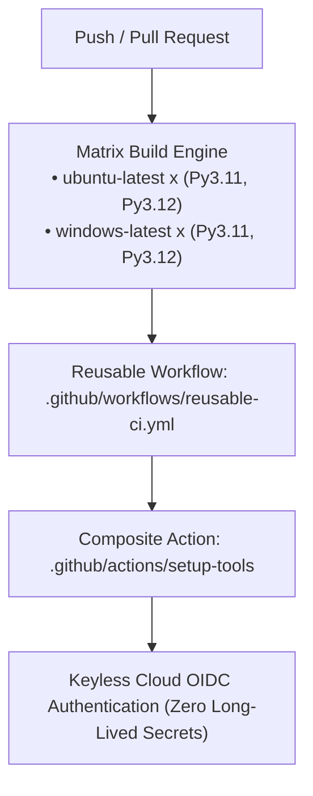

# Architecture Specification: Advanced GitHub Actions Patterns

## Architectural Pipeline Topology
Demonstrates enterprise CI/CD delivery patterns with reusable workflows, composite actions, matrix jobs, and keyless OIDC cloud federation.

