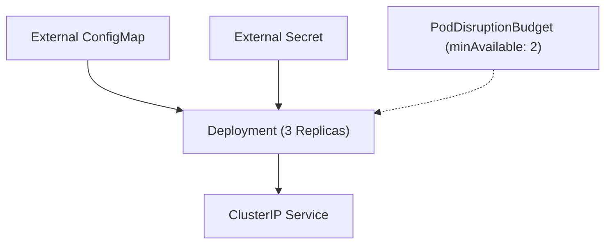

# Resilient Kubernetes Operational Patterns Lab

[](LICENSE)
[](https://kubernetes.io)
[](https://github.com/vikasrao-ops)

A practical engineering laboratory demonstrating operational resilience in Kubernetes: zero-downtime rolling updates, external configuration injection (ConfigMaps and Secrets), Pod Disruption Budgets (PDB), and fine-tuned probes.

---

## 1. Problem Statement
Naïve Kubernetes deployments suffer downtime during rolling updates, experience cluster-wide service outages during voluntary node drains, and couple configuration files directly into container images.

## 2. Architecture


## 3. Prerequisites
* Kubernetes cluster `>= 1.26` (Minikube, Kind, or managed cloud cluster)
* `kubectl` CLI

## 4. Technology Stack
* Kubernetes Core API (`apps/v1`, `policy/v1`, `v1`)
* Alpine NGINX Runtime

## 5. Repository Structure
* `manifests/app-workload.yaml`: Deployment, Service, ConfigMap, and Secret definitions.
* `manifests/pdb.yaml`: Pod Disruption Budget enforcing high availability during cluster upgrades.

## 6. Implementation & Execution
```bash
# Apply workloads
kubectl apply -f manifests/

# Verify zero-downtime update
kubectl set image deployment/lab-resilient-app web=nginx:1.26-alpine
kubectl rollout status deployment/lab-resilient-app
```

## 7. Expected Output
```text
configmap/lab-app-config created
secret/lab-app-secret created
deployment.apps/lab-resilient-app created
service/lab-resilient-svc created
poddisruptionbudget.policy/lab-app-pdb created
Waiting for deployment "lab-resilient-app" rollout to finish: 1 out of 3 new replicas have been updated...
deployment "lab-resilient-app" successfully rolled out
```

## 8. Security Considerations
* Database passwords and sensitive tokens are decoupled into Kubernetes Secrets.
* Strict resource limits prevent noisy-neighbor memory saturation.

## 9. Cost Considerations
* Lightweight baseline footprint (total requests < 150m CPU, 192Mi RAM across 3 pods).

## 10. Cleanup & Teardown
```bash
kubectl delete -f manifests/
```

## 11. Known Limitations
* Secret values in base Kubernetes are Base64 encoded; in production, pair with external secret operators (HashiCorp Vault or Azure Key Vault Provider for Secrets Store CSI Driver).

## 12. Future Improvements
* [ ] Integrate External Secrets Operator (ESO) syncing from AWS Secrets Manager / Azure Key Vault.
* [ ] Add KEDA (Kubernetes Event-driven Autoscaling) queue-based scaling.

