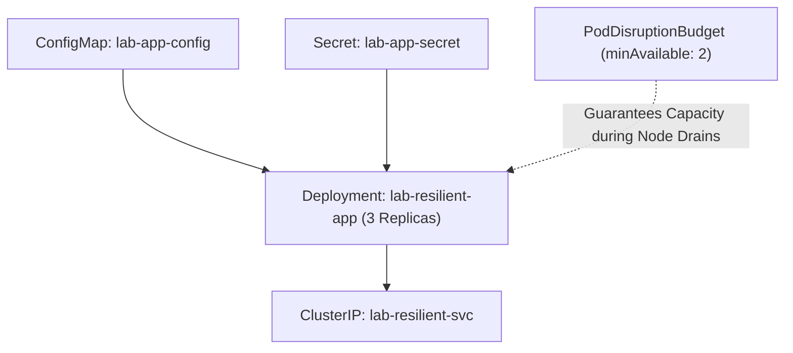

# Architecture Specification: Resilient Kubernetes Operations

## Architectural Primitives
Demonstrates high-availability deployment mechanics with zero-downtime rolling updates, external configuration injection, and Pod Disruption Budgets during node maintenance.

