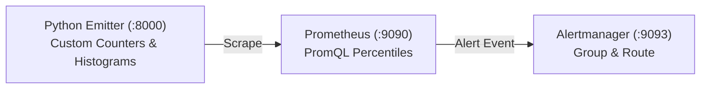

# Prometheus Custom Metrics & Alertmanager Engineering Lab

[](LICENSE)
[](https://prometheus.io)
[](https://prometheus.io/docs/alerting/latest/alertmanager/)

A focused telemetry engineering laboratory demonstrating custom Python application instrumentation, Prometheus histogram latency bucketing (P50, P95, P99), and Alertmanager notification routing.

---

## 1. Problem Statement
Default host metrics (CPU/RAM) do not reflect user-facing application health. Engineering teams require application-level instrumentation (traffic, error rate, latency) with percentile calculations and deduplicated alerting.

## 2. Architecture


## 3. Prerequisites
* Docker Engine `>= 24.0`
* Docker Compose `>= 2.20`

## 4. Technology Stack
* Prometheus v2.51
* Alertmanager v0.27
* Python Prometheus Client
* PromQL

## 5. Metric Reference
See [`examples/sample-promql-queries.md`](examples/sample-promql-queries.md) for latency quantile formulas.

## 6. Implementation & Execution
```bash
# Launch telemetry sandbox
docker compose up -d --build

# Inspect Prometheus UI
open http://localhost:9090
```

## 7. Expected Output
Querying `histogram_quantile(0.95, sum by (le) (rate(app_http_request_duration_seconds_bucket[1m])))` returns accurate sub-second latency percentiles.

## 8. Security Considerations
* Containers run in isolated Docker bridge network; interfaces are bound locally.

## 9. Cost Considerations
* Zero license fees; executes entirely on local container runtime.

## 10. Cleanup & Teardown
```bash
docker compose down
```

## 11. Known Limitations
* Alertmanager webhook receiver uses a placeholder endpoint for demonstration.

## 12. Future Improvements
* [ ] Integrate Grafana visualization dashboards.
* [ ] Add Slack and OpsGenie notification webhooks.

