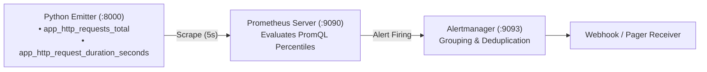

# Architecture Specification: Prometheus & Alertmanager Telemetry Lab

## Architectural Topology
Demonstrates custom application metric instrumentation with histogram latency bucketing and Alertmanager routing.

