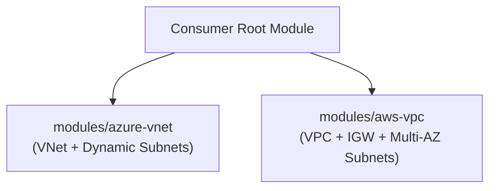

# Reusable Cloud Infrastructure Terraform Modules

[](LICENSE)
[](https://terraform.io)
[](https://github.com/vikasrao-ops)

A curated collection of modular, production-ready HashiCorp Terraform modules engineered for Microsoft Azure and AWS cloud networking and resource provisioning.

---

## 1. Problem Statement
Monolithic Terraform configurations lead to copy-paste drift, high blast radiuses, and inconsistent security baselines across teams. Reusable, versioned modules establish standardized, auditable infrastructure patterns.

## 2. Architecture


## 3. Prerequisites
* Terraform CLI `>= 1.5.0`
* Provider credentials for target cloud (Azure or AWS)

## 4. Technology Stack
* HashiCorp Terraform
* AzureRM Provider `>= 3.90`
* AWS Provider `>= 5.40`

## 5. Module Index
* [`modules/azure-vnet`](modules/azure-vnet): Provisions Virtual Network and parameterized subnet blocks with tags.
* [`modules/aws-vpc`](modules/aws-vpc): Provisions Multi-AZ VPC, Internet Gateway, and public subnet mappings.

## 6. Implementation & Example Usage
See [`examples/azure-vnet-usage.tf`](examples/azure-vnet-usage.tf):
```hcl
module "network" {
  source              = "git::https://github.com/vikasrao-ops/terraform-modules.git//modules/azure-vnet?ref=v1.0.0"
  vnet_name           = "vnet-prod"
  resource_group_name = "rg-network"
  location            = "eastus"
  address_space       = ["10.0.0.0/16"]
}
```

## 7. Expected Output
Modules expose standardized output IDs:
* `vnet_id` / `vpc_id`
* `subnet_ids` (map or list)

## 8. Security Considerations
* Subnet address spaces are validated; zero default open public ingress rules.

## 9. Cost Considerations
* Modules do not provision paid appliances (e.g. NAT Gateways) unless explicitly declared in input parameters.

## 10. Cleanup & Teardown
```bash
terraform destroy -auto-approve
```

## 11. Known Limitations
* Modules isolate networking layer; compute attachments are handled in consuming configurations.

## 12. Future Improvements
* [ ] Add GCP VPC module with Cloud NAT support.
* [ ] Integrate automated Terratest Go unit tests.

