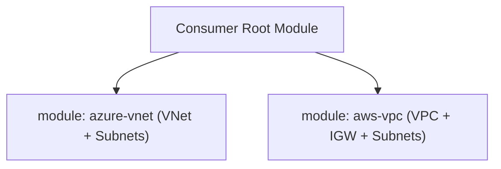

# Architecture Specification: Reusable Enterprise Terraform Modules

## Architectural Topology
Demonstrates modular Infrastructure as Code engineering. Separates core infrastructure building blocks into independently testable, version-controlled modules.

