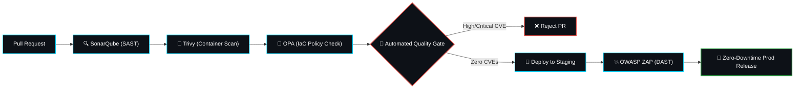

<!-- HERO SECTION: DYNAMIC ANIMATED WAVING HEADER -->
<div align="center">
  
  <!-- Animated Typing Tagline -->
  <a href="https://github.com/vikasrao-ops">
    
  </a>
  <br>
  <!-- Status & Social Ribbon -->
  <p align="center">
    <a href="https://linkedin.com/in/vikasrao-connect"></a>
    <a href="mailto:vikasrao.connect@gmail.com"></a>
    
    
  </p>
</div>
---
### 🧬 The Forward Deployed & Enterprise Mindset
```
                  "How To Engineer At Enterprise Scale?"
                                     │
           ┌─────────────────────────┴─────────────────────────┐
           ▼                                                   ▼
┌──────────────────────────────────────┐    ┌──────────────────────────────────────┐
│       BUSINESS & VALUE LAYER         │    │       SYSTEMS & PLATFORM LAYER       │
│ • Cloud Migration (Zero Downtime)    │    │ • Declarative IaC & GitOps (Terraform│
│ • FinOps (Waste Elimination & RIs)   │    │ • Kubernetes Orchestration (AKS/K8s) │
│ • 99.9% Uptime SLA & Rapid MTTR      │    │ • Shift-Left Security & OPA Policies │
│ • Multi-Tier Governance & Compliance │    │ • Full-Stack Telemetry (Prom/Grafana)│
└──────────────────────────────────────┘    └──────────────────────────────────────┘
```
---
### 🧰 The Modern Tech Matrix (Clickable Skill Dashboard)
    classDef hub fill:#0d1117,stroke:#00D8FF,stroke-width:2px,color:#fff;
    classDef spoke fill:#0d1117,stroke:#7B42BC,stroke-width:2px,color:#fff;
    classDef onprem fill:#161b22,stroke:#8b949e,stroke-width:1px,color:#8b949e;
    OnPrem["🏢 On-Premises Datacenter"] -->|ExpressRoute / VPN Gateway| Hub["🛡️ HUB VNet (Central Inspection)"]
    
    subgraph HubVNet ["HUB VNet Architecture"]
        Hub --> FW["🔥 Azure Firewall / NVA"]
        Hub --> DNS["🌐 Central Private DNS"]
    end
    FW -->|UDR: 0.0.0.0/0 Peering| Spoke1["🚀 Spoke 1: App Tier (Private Subnets + DB)"]
    FW -->|VNet Peering| Spoke2["⚙️ Spoke 2: Shared Tooling (CI/CD Runners, Bastion)"]
    class Hub,FW,DNS hub;
    class Spoke1,Spoke2 spoke;
    class OnPrem onprem;
```
<br>
#### **2. Automated DevSecOps Shift-Left Pipeline**

---
### 📂 Featured Production Repositories
          
        </a>
      </p>
    </td>
  </tr>
</table>
---
### 📈 GitHub Analytics & Real-Time Telemetry
<div align="center">
  
  
</div>
<br>
<div align="center">
  
</div>
---
<!-- FOOTER SECTION: ANIMATED WAVING CLOSING -->
<div align="center">
  <br>
  <h3>⚡ Let's Build Resilient Platforms Together</h3>
  <p>Available for <b>Platform Engineer</b>, <b>Site Reliability Engineer (SRE)</b>, and <b>DevOps & Multi-Cloud</b> roles.</p>
  
  <a href="https://linkedin.com/in/vikasrao-connect">
    
  </a>
  <a href="mailto:vikasrao.connect@gmail.com">
    
  </a>
  <br><br>
  
</div>

    
    
  
