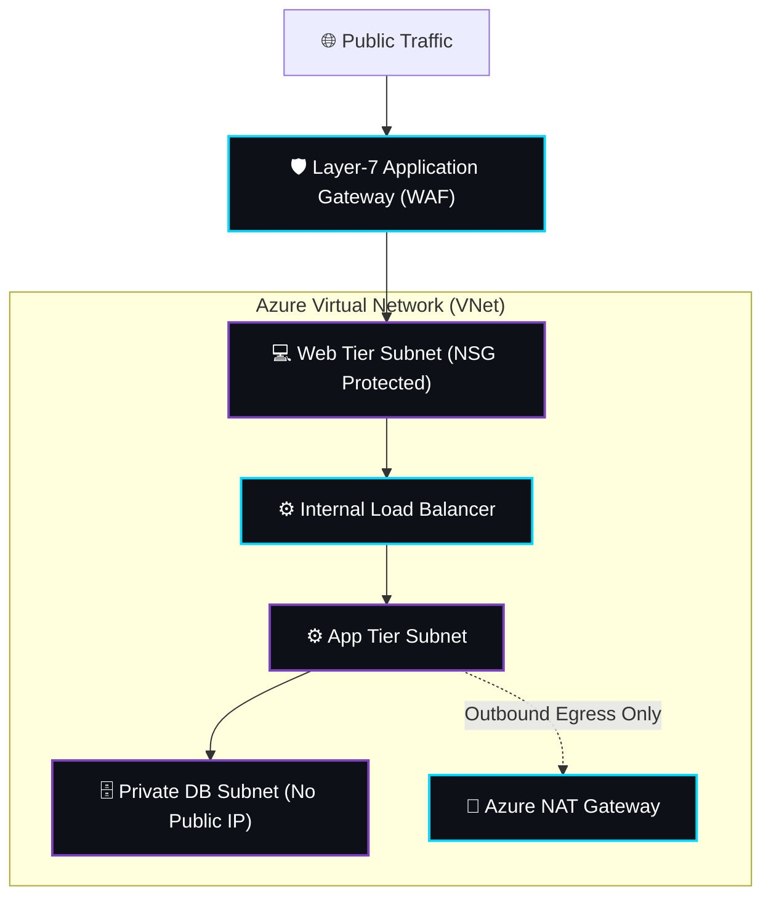
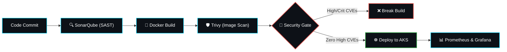

<!-- HERO SECTION: HIGH-CONTRAST DEEP NAVY ANIMATED HEADER -->

  

  <!-- Animated Typing Tagline: High-Contrast Royal Blue (Visible in both Light & Dark Mode) -->
  

    

  <!-- Status & Quick Links Ribbon -->
  

    
    
    
    
  

---

### 👨‍💻 About Me

I am an **Azure DevOps, DevSecOps, SRE, and Platform Engineer** with **2+ years of enterprise experience at Cognizant** delivering cloud infrastructure, automated CI/CD pipelines, and IaC solutions across pharmaceutical and UK retail client environments. 

Through structured, hands-on engineering at **DevOps Insiders**, I have expanded my capabilities into modern **Kubernetes (AKS) orchestration**, **GitOps governance with Atlantis/OPA**, and **automated DevSecOps security scanning**.

- 🏢 **Previous Experience:** Programmer Analyst (Azure Cloud & DevOps) at **Cognizant** (12/2021 – 02/2024).
- 🎯 **Target Roles:** Azure DevOps Engineer | DevSecOps Engineer | Site Reliability Engineer (SRE) | Platform Engineer.
- ⚡ **Key Metrics:** Reduced environment spin-up times by **65%** with Terraform, maintained **99.9% system uptime**, cut MTTR by **35%**, and reduced container images by **45%**.
- 📍 **Status:** Based in India | Open to Relocate (Bangalore / Pan-India / Remote) | Available to join **Immediately (0–15 Days)**.

---

### 🧰 Technical Skills Matrix

#### **Cloud Platforms & Containers**

 

#### **Infrastructure as Code & CI/CD Pipelines**

 

#### **SRE Observability, Security & Developer Tools**

 

*(Also Proficient In: `Azure DevOps YAML`, `SonarQube (SAST)`, `Trivy (Container Scan)`, `OWASP ZAP (DAST)`, `Azure Key Vault`, `Open Policy Agent (OPA)`, `Atlantis`, `Log Analytics (KQL)`, `Azure Monitor`)*

---

### 🏛️ Architecture & Pipeline Workflows

#### **1. Enterprise Azure Landing Zone & Network Isolation**

 

#### **2. Shift-Left DevSecOps Automated CI/CD Pipeline**

---

### 📂 Production Repositories & Real Implementations

<table>
  <tr>
    <td width="50%" valign="top">
      <h3>🛡️ <a href="https://github.com/vikasrao-ops/azure-devsecops-landingzone">Azure DevSecOps Landing Zone</a></h3>
      
<i>Terraform • Azure DevOps • SonarQube • Trivy • Key Vault</i>

      <ul>
        <li>Provisioned a secure 3-tier Azure landing zone with Layer-7 App Gateway, internal Load Balancers, and private subnets with NAT Gateway egress.</li>
        <li>Built automated YAML pipelines integrating SonarQube, Trivy, and OWASP ZAP with quality gates that reject high/critical findings.</li>
        <li>Eliminated 100% of hardcoded secrets using dynamic Azure Key Vault injection.</li>
      </ul>
      

        
      

    </td>
    <td width="50%" valign="top">
      <h3>⚙️ <a href="https://github.com/vikasrao-ops/terraform-azure-governance">Terraform GitOps Governance</a></h3>
      
<i>Terraform • Atlantis • GitHub Actions • Open Policy Agent (OPA)</i>

      <ul>
        <li>Implemented GitOps-based pull-request plan/apply workflows powered by Atlantis and GitHub Actions.</li>
        <li>Enforced policy-as-code compliance checks prior to deployment using Open Policy Agent (OPA).</li>
        <li>Managed remote state with automated blob leasing and state-locking on Azure Blob Storage.</li>
      </ul>
      

        
      

    </td>
  </tr>
  <tr>
    <td colspan="2" valign="top">
      <h3 align="center">☸️ <a href="https://github.com/vikasrao-ops/aks-microservices-pipeline">Kubernetes Microservices & SRE Observability</a></h3>
      
<i>Docker • Azure Kubernetes Service (AKS) • Prometheus • Grafana</i>

      

        Engineered multi-stage Dockerfiles reducing production image sizes by <b>45%</b>. Deployed container workloads to <b>AKS</b> with ingress routing, Horizontal Pod Autoscaling (HPA), and real-time SRE golden signal monitoring dashboards in Prometheus and Grafana.
      

      

        
      

    </td>
  </tr>
</table>

---

### 📈 GitHub Streak & Engineering Activity

  <!-- Live GitHub Streak Card (100% Reliable & Non-Rate-Limited) -->
  

    

  <!-- Key Metrics & Engineering Highlights -->
  

    
    
    
    
  

---

<!-- FOOTER SECTION -->

   
  <h3>📫 Let's Connect</h3>
  
Actively interviewing for <b>Azure DevOps Engineer</b>, <b>DevSecOps Engineer</b>, <b>SRE</b>, and <b>Platform Engineer</b> roles.

  
  
  

    
  

